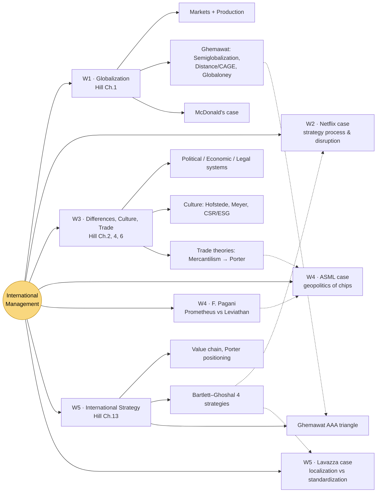
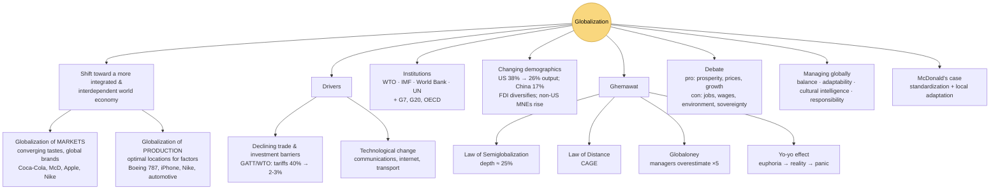
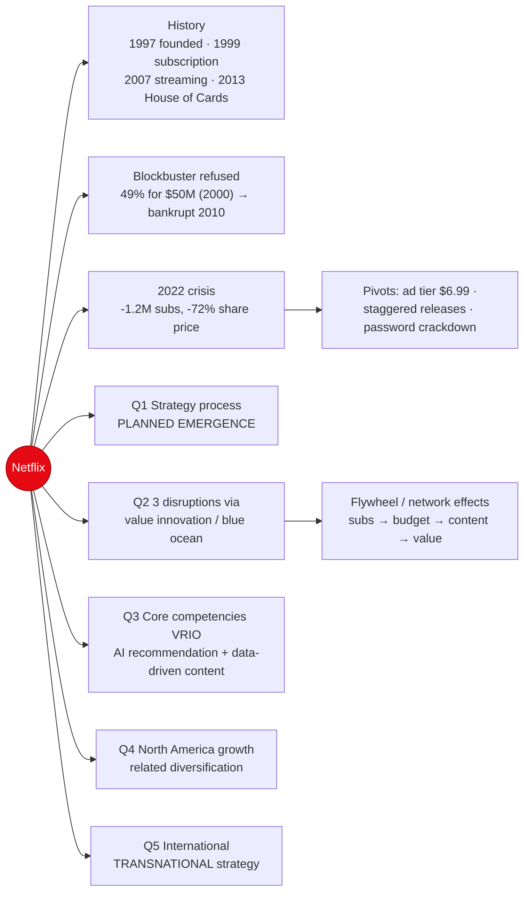
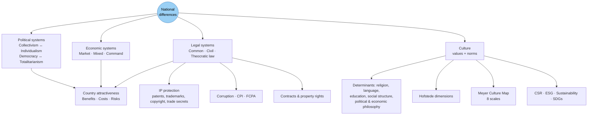
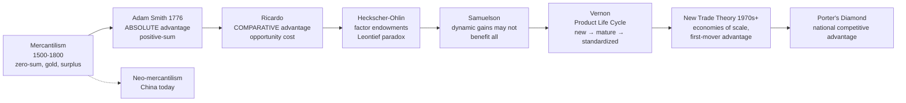
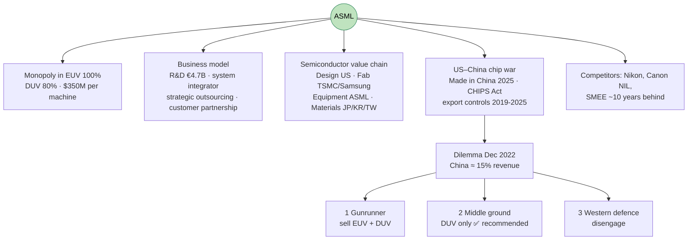
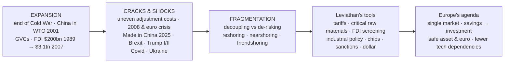
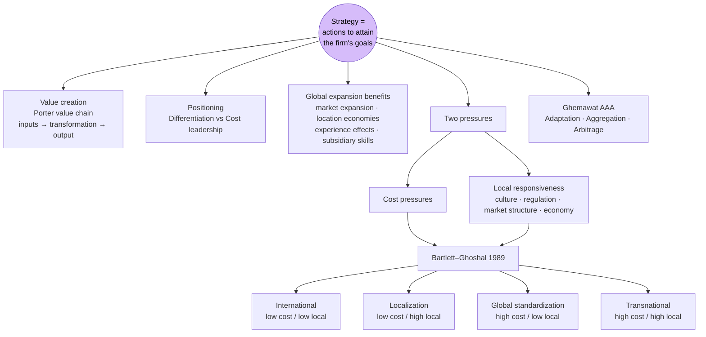
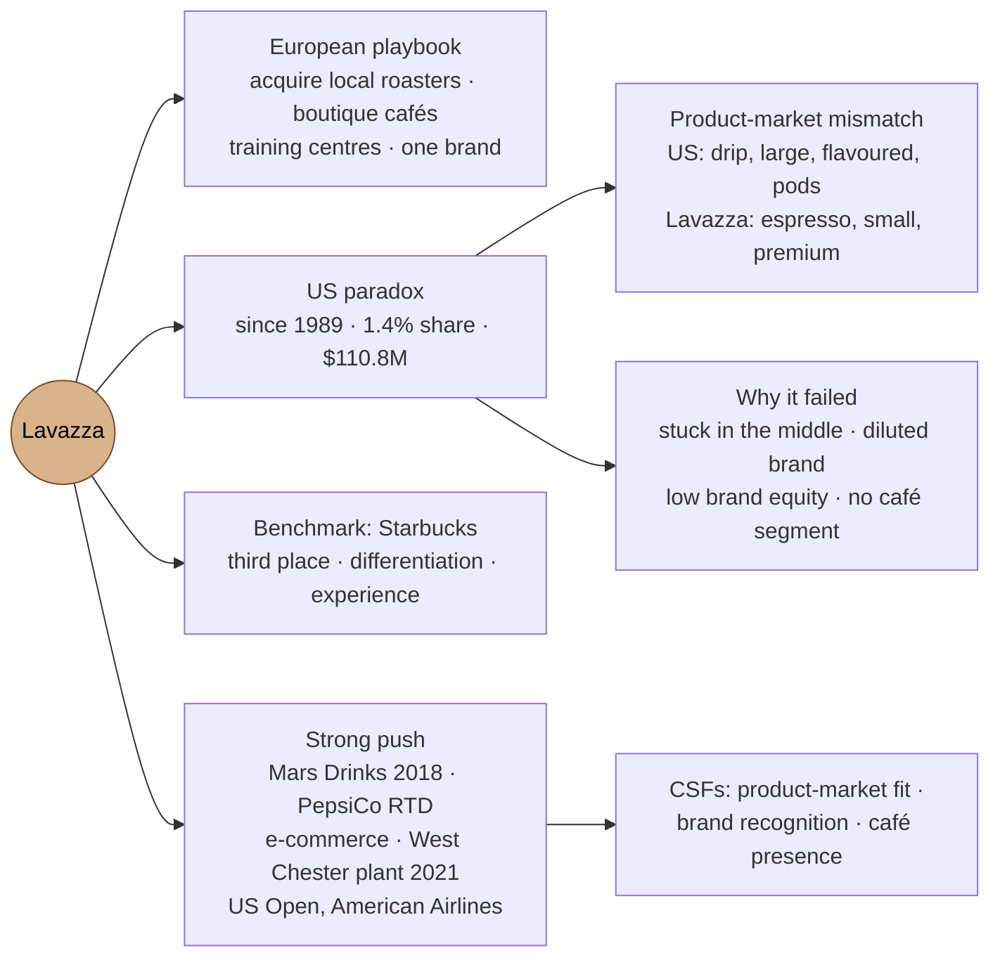
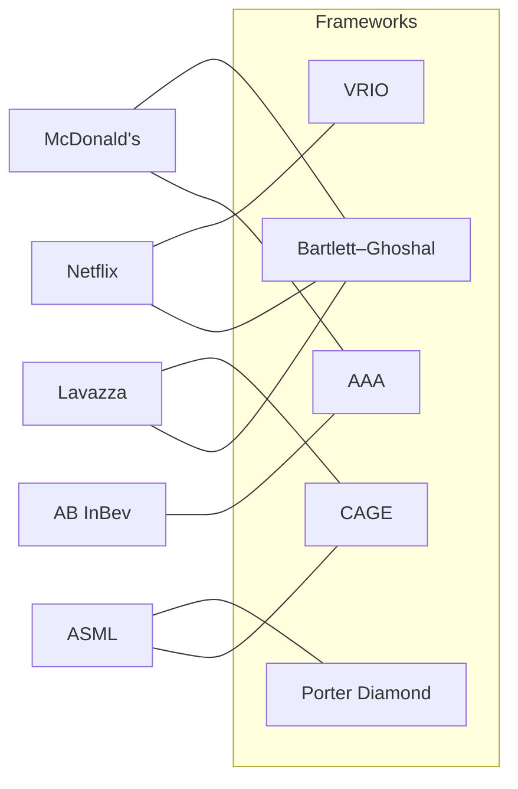

> [!Note] How to read this note
> - 📑 links open the **original PDF at the exact slide** (e.g. [[2026 IntMan ppt2 Week 1 Globalization.pdf#page=8|📑 ppt2 s.8]]).
> - Images are slide snapshots stored in `assets/` (`IM-pptXX-pYY-claude.webp`).
> - 🗺️ = concept map · ⭐ = very likely exam topic · Main textbook: **Hill, *International Business*** (Ch. 1, 2, 4, 6, 13)

# 🗺️ Course master map

---

# 0. Course organization & exam [[2026 IntMan ppt1 Week 1 Gen intro.pdf#page=12|📑 ppt1 s.12]]

| Item | Detail |
|---|---|
| Module | International Management, **3 ECTS**, Oct 5 → mid Nov (Digital Marketing, 9 ECTS, follows) |
| Weight | IM written exam = **25%** of final grade (DM = 75%) |
| Format | Moodle/STEM on lab PCs: **multiple choice (≤80%) + short open answers (20%)** [[2026 IntMan ppt1 Week 1 Gen intro.pdf#page=12|📑 ppt1 s.12]] |
| Dates | 2 Feb 2027 (VM8), 16 Feb 2027 (VM9), 8:30–12:30; + June/July, Aug/Sept |
| Rules | Up to 4 attempts/year; showing up again **scraps the previous grade**; register for "Prova Parziale" **and** "Prova Finale" |
| Content | Lessons + cases ("suggested materials are key") |

> [!example] Example exam questions [[2026 IntMan ppt1 Week 1 Gen intro.pdf#page=15|📑 ppt1 s.15]]
> - MCQ: *Main dynamics of globalization?* → **globalization of markets** and **globalization of production**.
> - Open: *Ghemawat's two "laws of globalization"* → **Law of Semiglobalization** and **Law of Distance**.

Bibliography [[2026 IntMan ppt1 Week 1 Gen intro.pdf#page=16|📑 ppt1 s.16]]: Hill (main) · Ghemawat *The New Global Road Map* · Grant *Contemporary Strategy Analysis* · Iger · Meyer *The Culture Map* · Miller *Chip War* · Moretti.

Course plan [[2026 IntMan ppt1 Week 1 Gen intro.pdf#page=17|📑 ppt1 s.17]]
![[IM-ppt01-p17-claude.webp|600]]

---

# 1. Globalization (Week 1 · Hill Ch.1) [[2026 IntMan ppt2 Week 1 Globalization.pdf#page=1|📑 ppt2 s.1]]

## 🗺️ Concept map – Globalization

## 1.1 Bigger picture

**Why IM matters** [[2026 IntMan ppt1 Week 1 Gen intro.pdf#page=7|📑 ppt1 s.7]] – trade flows are huge, yet the **Global Connectedness Index is much lower than most think**.

**Megatrends** [[2026 IntMan ppt2 Week 1 Globalization.pdf#page=4|📑 ppt2 s.4]] (Copenhagen Institute for Futures Studies) = *durable, directional structural forces* that reshape conditions for societies & organizations; historically specific, **resilient to individual action and short-term disruption**, persist for decades, impact >1 bn people.
1. Technology disruption & digital economy (+ energy transition)
2. Demographic shifts (urbanization, aging, health threats, inequality)
3. Climate change & resource scarcity
4. Social instability (at the **core** of PwC's wheel)
5. Fracturing world (political polarization)
![[IM-ppt02-p04-claude.webp|550]]

**New giants** [[2026 IntMan ppt2 Week 1 Globalization.pdf#page=5|📑 ppt2 s.5]] – top S&P 500 firms moved from **industrial/oil (1985)** to **HW/SW tech (2024)**. Interbrand Best Global Brands [[2026 IntMan ppt2 Week 1 Globalization.pdf#page=6|📑 ppt2 s.6]].
![[IM-ppt02-p05-claude.webp|500]]

**Uncertainty** – GEPU index [[2026 IntMan ppt2 Week 1 Globalization.pdf#page=7|📑 ppt2 s.7]] (GDP-weighted EPU of 18 countries, since 1997).

**Eras of globalization (Friedman/WEF)** [[2026 IntMan ppt2 Week 1 Globalization.pdf#page=8|📑 ppt2 s.8]] – context moves from **VUCA** (Volatile, Uncertain, Complex, Ambiguous) to **BANI** (Brittle, Anxious, Non-linear, Incomprehensible).

| Era | Period | Features |
|---|---|---|
| Globalization 1.0 | 1492–1800 | Imperialism, mercantilism, horse/wind |
| Globalization 2.0 | 1800–2000 | Multinationals, steam/rail, telegraph/telecom (1914–1989: era of large conflicts) |
| Globalization 3.0 | 2000–2015 | Individuals, PCs, internet, "levelling" |
| Globalization 4.0 | 2015–? | Always-on, pervasive tech, aging, high volatility; **Era of Fragmentation 2020– (boosted 2025)** |
![[IM-ppt02-p08-claude.webp|650]]

⭐ **Globalization Yo-Yo (Ghemawat)** [[2026 IntMan ppt2 Week 1 Globalization.pdf#page=9|📑 ppt2 s.9]] – expectations swing between extremes:
- **Euphoria** ("world is flat") → standardized strategies ignoring local differences
- **Reality check** (Lehman 2008) → limits of globalization revealed
- **Panic** (recent) → over-localization, losing scale + trade wars
- ➜ Ideal: **balance between global integration and local adaptation** ("easy to say, hard to realize")
![[IM-ppt02-p09-claude.webp|600]]

![[IM-ppt02-p10-claude.webp|500]]

## 1.2 Understanding globalization

⭐ **Definition** [[2026 IntMan ppt2 Week 1 Globalization.pdf#page=12|📑 ppt2 s.12]]: *shift toward a more integrated and interdependent world economy* (goods, services, technology, information, finance, people). Two major dynamics: **globalization of markets** + **globalization of production** – from "Made in Germany" to "Made by BMW".

| | Globalization of **Markets** [[2026 IntMan ppt2 Week 1 Globalization.pdf#page=13|📑 ppt2 s.13]] | Globalization of **Production** [[2026 IntMan ppt2 Week 1 Globalization.pdf#page=14|📑 ppt2 s.14]] |
|---|---|---|
| Meaning | Merging of distinct national markets into one global marketplace; converging tastes → standardized products (*"far from being that simple"*) | Sourcing goods/services from optimal locations to exploit national differences in **factors of production** (labour, energy, land, capital) |
| Drivers | Communication tech, global media, travel | Cost differences, specialized skills, resources |
| Examples | Coca-Cola, McDonald's, Apple, Nike | Boeing 787 (65% outsourced: wings JP, fuselage IT, engines UK); Nike (design Oregon, production Asia); US auto sourcing $90bn (Mexico, Canada, China…); software (India/California/E. Europe) |
| Trade-off | Scale economies vs local preferences | Efficiency vs complex, vulnerable supply chains |
![[IM-ppt02-p14-claude.webp|600]]

**iPhone – a truly global product** [[2026 IntMan ppt2 Week 1 Globalization.pdf#page=15|📑 ppt2 s.15]]: design/software California; semiconductors DE/TW; memory KR/JP; displays KR/TW; rare metals Africa/Asia; assembly China/Brazil/India. Apple keeps **design, software, marketing** in Cupertino (value-adding activities).
![[IM-ppt02-p15-claude.webp|500]]

**Key institutions** [[2026 IntMan ppt2 Week 1 Globalization.pdf#page=16|📑 ppt2 s.16]]

| Institution | Role |
|---|---|
| **WTO** (from GATT) | Monitors trading system, enforces rules; 164 members, 98% of world trade |
| **IMF** (1944) | Order in international monetary system; *lender of last resort* with conditions |
| **World Bank** | Development, low-interest loans for infrastructure |
| **UN** (1945) | Peace, human rights, development (~70% of activity economic/social) |
| Also | G7, G20, OECD (OCSE) |

**Changing demographics of the global economy** [[2026 IntMan ppt2 Week 1 Globalization.pdf#page=17|📑 ppt2 s.17]] [[2026 IntMan ppt2 Week 1 Globalization.pdf#page=18|📑 ppt2 s.18]]: 1960 US = 38.3% of world output, 20% of exports → today US 26%, **China 17%**, China #1 exporter since 2017, BRICS growing, share of advanced economies declining.
![[IM-ppt02-p17-claude.webp|600]]

⭐ **Primary drivers** [[2026 IntMan ppt2 Week 1 Globalization.pdf#page=19|📑 ppt2 s.19]]
1. **Declining trade & investment barriers** – GATT/WTO: avg tariffs from >40% (1950) to ~2–3% (before Trump 47); regional agreements (EU, NAFTA); FDI laws more favourable since 2000.
2. **Technological change** – microprocessors, satellites, fibre; internet (68% of population, ITU 2024); jets, **containerization**, superfreighters.

**Implications of tech change** [[2026 IntMan ppt2 Week 1 Globalization.pdf#page=20|📑 ppt2 s.20]] – *Markets*: e-marketplaces, lower cultural distance, global brands/consumers, entry for small firms. *Production*: coordinate dispersed systems, outsourcing, optimal locations, cross-border JIT, 24-h work cycles. ⚠️ National differences persist – ignoring them is perilous.

**FDI landscape** [[2026 IntMan ppt2 Week 1 Globalization.pdf#page=21|📑 ppt2 s.21]] [[2026 IntMan ppt2 Week 1 Globalization.pdf#page=22|📑 ppt2 s.22]]: 1960s US = 66.3% of FDI flows (UK 10.5%, Japan 2%) → today diversified; US outward FDI stock 13% GDP (1995) → 35% (2018). Trends: sustained FDI growth since 1990; developing nations as destinations (China ≈ $250bn inflows, 2020).
![[IM-ppt02-p22-claude.webp|550]]

**Changing MNE** [[2026 IntMan ppt2 Week 1 Globalization.pdf#page=23|📑 ppt2 s.23]]: US share of top-2000 MNEs 38.8% (2003) → 28.8% (2019); China 15.5%; Japan 11.1%; rise of Taiwan, India, Korea; **mini-multinationals** enabled by internet.

## 1.3 ⭐ Ghemawat's laws

**Law of Semiglobalization** [[2026 IntMan ppt2 Week 1 Globalization.pdf#page=24|📑 ppt2 s.24]] – *"International interactions, while significant, are much less intense than domestic interactions."* Average depth ratio across trade, capital, information, people ≈ **25%** (e.g. exports ≈ 29% of GDP, MNE output ≈ 11%, cross-border internet traffic ≈ 14%).
![[IM-ppt02-p24-claude.webp|600]]

**Law of Distance – CAGE framework** [[2026 IntMan ppt2 Week 1 Globalization.pdf#page=25|📑 ppt2 s.25]] – *interactions are dampened by distance along cultural, administrative, geographic and economic dimensions.*

| Dimension | Effect |
|---|---|
| **C**ultural | Language, religion, values; *common language doubles trade & FDI* |
| **A**dministrative | Political hostility, no trade agreements, different currencies; *colonial ties ×2.5* |
| **G**eographic | *Halving distance more than triples trade & doubles FDI* |
| **E**conomic | Income differences can boost (arbitrage) or dampen (preferences) trade |
![[IM-ppt02-p25-claude.webp|600]]

**Globaloney** [[2026 IntMan ppt2 Week 1 Globalization.pdf#page=26|📑 ppt2 s.26]] – managers **overestimate globalization ×5**. Reality: <0.1% of firms have foreign operations; only 1% export; median US MNE in **3 countries**; distance still matters. ➜ Leverage natural advantages and closest relationships. Stress tests: 1929, 2008, Trump tariffs. Proof via trade distance/regionalization [[2026 IntMan ppt2 Week 1 Globalization.pdf#page=27|📑 ppt2 s.27]].

**DHL Global Connectedness Index** [[2026 IntMan ppt2 Week 1 Globalization.pdf#page=28|📑 ppt2 s.28]] [[2026 IntMan ppt 3 Week 2 Recap and Netflix.pdf#page=4|📑 ppt3 s.4]] – 183 countries; bumps in 2008 & 2020, **stable ≈ 25% since COVID**. Country maps (Italy, UK) show flows shrinking with distance [[2026 IntMan ppt 3 Week 2 Recap and Netflix.pdf#page=5|📑 ppt3 s.5]].
![[IM-ppt02-p28-claude.webp|550]]
![[IM-ppt03-p05-claude.webp|550]]

## 1.4 Implications, debate, management

**21st-century global economy** [[2026 IntMan ppt2 Week 1 Globalization.pdf#page=30|📑 ppt2 s.30]]: falling barriers (with counter-trends), rising economies (S. Korea, Taiwan), liberal policy shifts (with reversals). **Greater risks**: financial contagion (1997–98 Asia, 2008–09), supply-chain vulnerability, competition, political backlash/nationalism, **AI disruption**.

**Globalization debate** [[2026 IntMan ppt2 Week 1 Globalization.pdf#page=31|📑 ppt2 s.31]] [[2026 IntMan ppt2 Week 1 Globalization.pdf#page=32|📑 ppt2 s.32]]

| Supporters | Critics |
|---|---|
| Lower barriers → prosperity, lower prices, growth, higher incomes, jobs | Job losses, wage pressure on unskilled, environmental degradation, cultural imperialism, loss of sovereignty |
| Specialization: whole economy benefits, rising incomes abroad create export markets | Production moves to low-wage countries; global labour pool ×5 since 1990; "exporting jobs" |

> [!warning] Note: on slide 32 the column headers appear swapped vs content — content above is placed logically.

⭐ **Managing in the global marketplace** [[2026 IntMan ppt2 Week 1 Globalization.pdf#page=33|📑 ppt2 s.33]]: *Cross-cultural complexity · Strategic flexibility · Expanded decision-making* → managers need **Balance** (integration vs responsiveness), **Adaptability**, **Cultural intelligence**, **Responsibility**.
![[IM-ppt02-p33-claude.webp|600]]

## 1.5 Case: McDonald's [[2026 IntMan ppt2 Week 1 Globalization.pdf#page=34|📑 ppt2 s.34]]

- Prototype of **globalization of markets**: 40K+ restaurants, 120+ countries, 69M daily customers, 1.9M workforce, **80% franchised**, 40K+ suppliers [[2026 IntMan ppt2 Week 1 Globalization.pdf#page=35|📑 ppt2 s.35]].
- **Local adaptation** [[2026 IntMan ppt2 Week 1 Globalization.pdf#page=36|📑 ppt2 s.36]] [[2026 IntMan ppt2 Week 1 Globalization.pdf#page=37|📑 ppt2 s.37]]: India *Maharaja Mac* (no beef), Asia rice burgers, Middle East halal.
- Symbol of anti-globalization ("McDonaldisation", France 1999 attack) [[2026 IntMan ppt2 Week 1 Globalization.pdf#page=38|📑 ppt2 s.38]] → **French paradox**: France among most profitable markets, 1,200+ restaurants, 69K employees [[2026 IntMan ppt2 Week 1 Globalization.pdf#page=39|📑 ppt2 s.39]].
- **Hybrid supply chain**: global standardization (brand, procedures, quality) + local adaptation (menu, price, design, marketing) [[2026 IntMan ppt2 Week 1 Globalization.pdf#page=40|📑 ppt2 s.40]].
- **Entry by development level** [[2026 IntMan ppt2 Week 1 Globalization.pdf#page=41|📑 ppt2 s.41]]: developed → direct investment/company-owned; emerging → franchising/JV; developing → gradual expansion.
- **Tech**: digital kiosks (2017) +20–30% average order value; sustainability, ethics, community [[2026 IntMan ppt2 Week 1 Globalization.pdf#page=42|📑 ppt2 s.42]].
![[IM-ppt02-p37-claude.webp|550]]
![[IM-ppt02-p40-claude.webp|550]]
![[IM-ppt02-p41-claude.webp|500]]

---

# 2. Case: Netflix – Streaming wars (Week 2) [[2026 IntMan ppt 3 Week 2 Recap and Netflix.pdf#page=11|📑 ppt3 s.11]]

*HBR case MH0080 (Feb 2023). Co-CEOs Sarandos & Peters: tactical adjustments or fundamental shift?*

## 🗺️ Concept map – Netflix

**Key metrics** [[2026 IntMan ppt 3 Week 2 Recap and Netflix.pdf#page=13|📑 ppt3 s.13]]: 223M subs Q4 2022 (300M in 2025), ARPU $11.67, churn 3.3% (industry ≈7%), 100M+ password sharers, $17B content spend.

**Timeline** [[2026 IntMan ppt 3 Week 2 Recap and Netflix.pdf#page=14|📑 ppt3 s.14]]: 1998 DVD by mail → 1999 Marquee plan, no late fees → 2002 IPO → 2007 VoD → 2013 *House of Cards* ($100M).
![[IM-ppt03-p14-claude.webp|550]]

**Blockbuster – cautionary tale** [[2026 IntMan ppt 3 Week 2 Recap and Netflix.pdf#page=15|📑 ppt3 s.15]]: in 2000 refused to buy 49% of Netflix for ~$50M (BB: 8,000 stores, $5B revenue); online only in 2004; bankrupt 2010.

**2022 crisis** [[2026 IntMan ppt 3 Week 2 Recap and Netflix.pdf#page=16|📑 ppt3 s.16]]: −1.2M subs, share −72%, market cap $306B → $74B. Q4 2022: +7.7M. *Market cap = share price × outstanding shares.*
**Pivots** [[2026 IntMan ppt 3 Week 2 Recap and Netflix.pdf#page=17|📑 ppt3 s.17]]: ad-supported tier, staggered releases, password crackdown. Leadership: Hastings → Exec. Chairman; Peters + Sarandos co-CEOs [[2026 IntMan ppt 3 Week 2 Recap and Netflix.pdf#page=18|📑 ppt3 s.18]].

**Streaming wars** [[2026 IntMan ppt 3 Week 2 Recap and Netflix.pdf#page=19|📑 ppt3 s.19]] [[2026 IntMan ppt 3 Week 2 Recap and Netflix.pdf#page=20|📑 ppt3 s.20]] [[2026 IntMan ppt 3 Week 2 Recap and Netflix.pdf#page=21|📑 ppt3 s.21]]: Amazon Prime (200M, bundled ecosystem), Disney+ (165M), Apple TV+, HBO Max; rivals lose $10B+/yr while Netflix earns $5B+.
![[IM-ppt03-p20-claude.webp|550]]

**Strategic challenges** [[2026 IntMan ppt 3 Week 2 Recap and Netflix.pdf#page=22|📑 ppt3 s.22]] [[2026 IntMan ppt 3 Week 2 Recap and Netflix.pdf#page=23|📑 ppt3 s.23]]: culture (top performers, layoffs), quality vs quantity, business-model shift, password sharing, **international imbalance** ("majority US viewing… YouTube/Facebook are 80% international" – Hastings); low prices abroad ($2.44 India), losses outside EU/US-Canada, limited internet in Africa.

## Solutions [[2026 IntMan ppt 4 Week 2 Netflix case - the Solutions.pdf#page=1|📑 ppt4 s.1]]

| Q | Answer |
|---|---|
| **1 Strategy process** [[2026 IntMan ppt 4 Week 2 Netflix case - the Solutions.pdf#page=5|📑 ppt4 s.5]] | ⭐ **Strategy as planned emergence**: top-down intent + bottom-up emergent initiatives (vs strategic/scenario planning). Ex: *long tail* discovery, data-driven *House of Cards*. Failures of top-down: **Qwikster 2011**; 2022 ad tier & crackdown [[2026 IntMan ppt 4 Week 2 Netflix case - the Solutions.pdf#page=6|📑 ppt4 s.6]]. Risk: can it scale with costs & complexity? |
| **2 Disruption** [[2026 IntMan ppt 4 Week 2 Netflix case - the Solutions.pdf#page=8|📑 ppt4 s.8]] | 3 disruptions through **value innovation**: (1) DVD by mail – no late fees, niche content; (2) Streaming – cheaper than cable, no ads, binge, **blue ocean**; (3) Content production – **backward integration**. **Flywheel/network effects** [[2026 IntMan ppt 4 Week 2 Netflix case - the Solutions.pdf#page=9|📑 ppt4 s.9]] |
| **3 Core competencies** [[2026 IntMan ppt 4 Week 2 Netflix case - the Solutions.pdf#page=11|📑 ppt4 s.11]] | **VRIO**: proprietary **recommendation engine** + **AI-driven content investment** = *isolating mechanisms*; must keep innovating |
| **4 NA growth** [[2026 IntMan ppt 4 Week 2 Netflix case - the Solutions.pdf#page=12|📑 ppt4 s.12]] [[2026 IntMan ppt 4 Week 2 Netflix case - the Solutions.pdf#page=13|📑 ppt4 s.13]] | *Related-constrained*: live sports, news, foreign-language content, gaming; *related-linked*: merchandise, advertising, product placement. Unrelated diversification unlikely |
| **5 International** [[2026 IntMan ppt 4 Week 2 Netflix case - the Solutions.pdf#page=15|📑 ppt4 s.15]] | ⭐ **Transnational strategy**: local low-budget content that breaks out globally (*Squid Game, Money Heist, Dark, Lupin*), thousands of experiments; priority: profitable markets (Canada, W. Europe, Korea, Japan, Australia, Gulf, India…); China closed. Fast entry to **190 countries** (languages, algorithms, device/payment partners) [[2026 IntMan ppt 4 Week 2 Netflix case - the Solutions.pdf#page=16|📑 ppt4 s.16]]; **mobile-first** for emerging markets [[2026 IntMan ppt 4 Week 2 Netflix case - the Solutions.pdf#page=17|📑 ppt4 s.17]] |
![[IM-ppt04-p09-claude.webp|450]]

![[IM-ppt04-p15-claude.webp|600]]

Takeaways [[2026 IntMan ppt 4 Week 2 Netflix case - the Solutions.pdf#page=18|📑 ppt4 s.18]]
![[IM-ppt04-p18-claude.webp|550]]

---

# 3. Differences, Culture, Trade (Week 3 · Hill Ch.2, 4, 6) [[2026 IntMan ppt 5 Week 3 Gov Cult Trade.pdf#page=1|📑 ppt5 s.1]]

## 🗺️ Concept map – National differences

## 3.1 Political, economic, legal systems

- **Political** [[2026 IntMan ppt 5 Week 3 Gov Cult Trade.pdf#page=5|📑 ppt5 s.5]]: *Collectivism* (society over individual; socialism, social democracy, totalitarianism) vs *Individualism & democracy* (private property, economic freedom, free media/elections).
- **Economic** [[2026 IntMan ppt 5 Week 3 Gov Cult Trade.pdf#page=6|📑 ppt5 s.6]]: *Market* (private ownership, prices) · *Mixed* (private + state, regulated sectors/monopolies) · *Command* (state plans & owns, central prices).
- **Legal** [[2026 IntMan ppt 5 Week 3 Gov Cult Trade.pdf#page=7|📑 ppt5 s.7]]: *Common law* (tradition, precedent; UK/US) · *Civil law* (detailed codes; 80+ countries incl. EU, Japan) · *Theocratic* (religion; Islamic law).
![[IM-ppt05-p06-claude.webp|450]]
![[IM-ppt05-p07-claude.webp|450]]

**IP & corruption** [[2026 IntMan ppt 5 Week 3 Gov Cult Trade.pdf#page=8|📑 ppt5 s.8]]: IP = patents, trademarks, copyrights, trade secrets; >80% of IP theft from developing economies. Corruption (bribery, extortion, nepotism) measured by **Transparency International CPI**. Mitigation: register IP everywhere, due diligence, NDAs, monitoring, **FCPA** compliance, transparent reporting, ethical culture top-down.

**Contracts & property** [[2026 IntMan ppt 5 Week 3 Gov Cult Trade.pdf#page=9|📑 ppt5 s.9]]: common law → long detailed contracts; civil law → shorter contracts based on codes. Secure property rights → investment; weak systems → expropriation risk.

⭐ **Country attractiveness = f(Benefits, Costs, Risks)** [[2026 IntMan ppt 5 Week 3 Gov Cult Trade.pdf#page=10|📑 ppt5 s.10]] (Hill Fig. 3.1)
![[IM-ppt05-p10-claude.webp|500]]

## 3.2 Culture

**Definition** [[2026 IntMan ppt 5 Week 3 Gov Cult Trade.pdf#page=13|📑 ppt5 s.13]]: dynamic system of **values** (abstract ideas of good/right/desirable) and **norms** (social rules for behaviour), shared by a group, transmitted by institutions, may transcend borders. *"How you feel on Sunday night about your work the following morning."* Determinants: religion, political & economic philosophy, education, language, social structure.
![[IM-ppt05-p13-claude.webp|500]]

- **Social structure** [[2026 IntMan ppt 5 Week 3 Gov Cult Trade.pdf#page=14|📑 ppt5 s.14]]: individuals vs groups (West vs Japan); stratification — class (mobile) vs caste (rigid).
- **Religions** [[2026 IntMan ppt 5 Week 3 Gov Cult Trade.pdf#page=15|📑 ppt5 s.15]]: Christianity (Protestant work ethic ↔ capitalism), Islam (no interest → Islamic banking), Hinduism (caste, karma, dharma), Buddhism (spiritual over material).
- **Language** [[2026 IntMan ppt 5 Week 3 Gov Cult Trade.pdf#page=16|📑 ppt5 s.16]]: 6,000+ languages, English as lingua franca; unspoken language (body language, space, gestures).
- **Business implications** [[2026 IntMan ppt 5 Week 3 Gov Cult Trade.pdf#page=17|📑 ppt5 s.17]]: management, marketing, negotiation styles.

**Hofstede** [[2026 IntMan ppt 5 Week 3 Gov Cult Trade.pdf#page=18|📑 ppt5 s.18]] – comparative values research started at IBM (Culture Factor country comparison tool).
![[IM-ppt05-p18-claude.webp|550]]

⭐ **Erin Meyer – The Culture Map (8 scales)** [[2026 IntMan ppt 5 Week 3 Gov Cult Trade.pdf#page=19|📑 ppt5 s.19]]

| Scale         | From                     | To                         |
| ------------- | ------------------------ | -------------------------- |
| Communicating | Low-context              | High-context               |
| Evaluating    | Direct negative feedback | Indirect negative feedback |
| Persuading    | Principles-first         | Applications-first         |
| Leading       | Egalitarian              | Hierarchical               |
| Deciding      | Consensual               | Top-down                   |
| Trusting      | Task-based               | Relationship-based         |
| Disagreeing   | Confrontational          | Avoids confrontation       |
| Scheduling    | Linear-time              | Flexible-time              |
*(Meyer co-authored "No Rules Rules" with Reed Hastings → link to Netflix)*

**CSR & ESG** [[2026 IntMan ppt 5 Week 3 Gov Cult Trade.pdf#page=20|📑 ppt5 s.20]]: CSR = internal self-regulated efforts on social/environmental consequences; **ESG** = measurable criteria used by investors (EcoVadis). **Sustainability** [[2026 IntMan ppt 5 Week 3 Gov Cult Trade.pdf#page=21|📑 ppt5 s.21]]: meet present needs without compromising future generations; **UN 17 SDGs (Agenda 2030)**; Environmental stewardship = E, Economic responsibility ↔ G.

## 3.3 International trade theories

## 🗺️ Concept map – Trade theories

| Theory                              | Key idea                                                                                                                                      | Slide                                                 |                |
| ----------------------------------- | --------------------------------------------------------------------------------------------------------------------------------------------- | ----------------------------------------------------- | -------------- |
| **Mercantilism**                    | Wealth = gold/silver; export > import; government intervention; **zero-sum**. Neo-mercantilism: China (currency, export promotion)            | [[2026 IntMan ppt 5 Week 3 Gov Cult Trade.pdf#page=26 | 📑 ppt5 s.26]] |
| **Absolute advantage** (Smith 1776) | Specialize where you are most efficient, buy the rest; **positive-sum** (cocoa/rice PPF)                                                      | [[2026 IntMan ppt 5 Week 3 Gov Cult Trade.pdf#page=27 | 📑 ppt5 s.27]] |
| **Comparative advantage** (Ricardo) | Gains even if one country is better at everything – specialize in **lowest opportunity cost**; consumption beyond PPF                         | [[2026 IntMan ppt 5 Week 3 Gov Cult Trade.pdf#page=28 | 📑 ppt5 s.28]] |
| **Heckscher–Ohlin**                 | Export goods intensive in **abundant factors**; *Leontief paradox* contradicts it                                                             | [[2026 IntMan ppt 5 Week 3 Gov Cult Trade.pdf#page=29 | 📑 ppt5 s.29]] |
| **Samuelson**                       | Dynamic gains can be non-beneficial; free trade historically favoured rich countries                                                          | [[2026 IntMan ppt 5 Week 3 Gov Cult Trade.pdf#page=29 | 📑 ppt5 s.29]] |
| **Product Life Cycle** (Vernon)     | New (developed, home market) → maturing (exports, some foreign production) → standardized (production moves to developing, innovator imports) | [[2026 IntMan ppt 5 Week 3 Gov Cult Trade.pdf#page=30 | 📑 ppt5 s.30]] |
| **New Trade Theory**                | Trade between similar countries: **economies of scale**, product variety, **first-mover advantages**                                          | [[2026 IntMan ppt 5 Week 3 Gov Cult Trade.pdf#page=31 | 📑 ppt5 s.31]] |
| ⭐ **Porter's Diamond**              | Factor endowments · Demand conditions · Related & supporting industries · Firm strategy, structure & rivalry                                  | [[2026 IntMan ppt 5 Week 3 Gov Cult Trade.pdf#page=32 | 📑 ppt5 s.32]] |
![[IM-ppt05-p27-claude.webp|450]]
![[IM-ppt05-p28-claude.webp|450]]
![[IM-ppt05-p32-claude.webp|500]]

**Transformation patterns** [[2026 IntMan ppt 5 Week 3 Gov Cult Trade.pdf#page=34|📑 ppt5 s.34]]: microwaves 99% produced in emerging economies; automotive 20% → 60%; commercial aircraft only 3% produced but 47% sold there; China leads consumption in 18/34 industries.
**Future of trade** [[2026 IntMan ppt 5 Week 3 Gov Cult Trade.pdf#page=35|📑 ppt5 s.35]]: goods 40% of value added exported vs services 15% (services >67% of GDP) → services are the next driver (regulatory barriers).
**Multipolarity** [[2026 IntMan ppt 5 Week 3 Gov Cult Trade.pdf#page=36|📑 ppt5 s.36]]: EU, US, China, India, Brazil as regional poles. **US–China** [[2026 IntMan ppt 5 Week 3 Gov Cult Trade.pdf#page=37|📑 ppt5 s.37]]: China largest by PPP and exports, may surpass US GDP by ~2037; US leads services, high-tech, finance, demographics, alliances.
![[IM-ppt05-p36-claude.webp|500]]

**Wrap-up** [[2026 IntMan ppt 5 Week 3 Gov Cult Trade.pdf#page=38|📑 ppt5 s.38]] [[2026 IntMan ppt 5 Week 3 Gov Cult Trade.pdf#page=39|📑 ppt5 s.39]] [[2026 IntMan ppt 5 Week 3 Gov Cult Trade.pdf#page=40|📑 ppt5 s.40]]: managerial implications = **Location · First-mover advantages · Government policy**; emerging markets = growth 5–8% & large middle class vs political/currency/IP risks; trends = deglobalization risk, regional blocs, AI, sustainability, digital connectivity, platforms, **data as a traded good**.

---

# 4. Case: ASML – Geopolitics of chips (Week 4) [[2026 IntMan ppt 6 Week 4 ASML case.pdf#page=3|📑 ppt6 s.3]]

*Harvard/Ivey case W34163 (Jan 2024). Can a private firm's strategy yield to national security?*

## 🗺️ Concept map – ASML

**ASML today** [[2026 IntMan ppt 6 Week 4 ASML case.pdf#page=4|📑 ppt6 s.4]]: Europe's largest tech company (≈$592B market cap), revenue €32.7B (2025), net income €9.6B, gross margin 52.8%, 44,000 employees from 143 nationalities; origins 1984 JV (Philips–ASM).

![[IM-ppt06-p04-claude.webp|600]]

- **Dilemma** [[2026 IntMan ppt 6 Week 4 ASML case.pdf#page=5|📑 ppt6 s.5]]: after US export restrictions (Dec 2022): maximize profit with China or align with Western policy. *Monopoly* (Cambridge def.) · *Moore's Law* (transistors double ≈ every 2 years).
- **Leadership** [[2026 IntMan ppt 6 Week 4 ASML case.pdf#page=6|📑 ppt6 s.6]]: Wennink CEO 2013–2024 (+260% profit) → Christophe Fouquet.
- **Why semiconductors matter** [[2026 IntMan ppt 6 Week 4 ASML case.pdf#page=7|📑 ppt6 s.7]]: $3T direct GDP contribution, defence, AI/IoT/5G. **Chip war** [[2026 IntMan ppt 6 Week 4 ASML case.pdf#page=8|📑 ppt6 s.8]]: China spends more on chips than oil; CHIPS & Science Act (9 Aug 2022).
- **Value chain** [[2026 IntMan ppt 6 Week 4 ASML case.pdf#page=9|📑 ppt6 s.9]]: design US (~46%), fabrication East Asia (TSMC 54%, Samsung 17%), equipment (ASML, Applied Materials, Lam), materials JP/KR/TW; ~25 countries per segment → unilateral restrictions hard.
- 
![[IM-ppt06-p09-claude.webp|550]]

- **Dominance** [[2026 IntMan ppt 6 Week 4 ASML case.pdf#page=10|📑 ppt6 s.10]]: EUV 100% (13.5 nm light), DUV 80% (KrF/ArF; vs Nikon, Canon).
- **Business model** [[2026 IntMan ppt 6 Week 4 ASML case.pdf#page=11|📑 ppt6 s.11]]: innovation through collaboration (R&D, 11K engineers) · **strategic outsourcing** (keeps only system design in-house, integrates global suppliers) · customer partnership (field service, training).
- **Competitors** [[2026 IntMan ppt 6 Week 4 ASML case.pdf#page=12|📑 ppt6 s.12]]: Nikon (exited EUV 2011), Canon (nanoimprint), SMEE (state-owned China, ~decade behind).
- **Revenue by region** [[2026 IntMan ppt 6 Week 4 ASML case.pdf#page=13|📑 ppt6 s.13]] [[2026 IntMan ppt 7 Week 4 ASML case - The Solutions.pdf#page=3|📑 ppt7 s.3]]: Taiwan 39.4%, S. Korea 33.4%, **China 14.7%** (2021, all products; EUV = 46% of sales).

![[IM-ppt07-p03-claude.webp|550]]

- **Timeline** [[2026 IntMan ppt 6 Week 4 ASML case.pdf#page=14|📑 ppt6 s.14]]: 2015 Made in China 2025 → 2019 first EUV ban → 2022 CHIPS Act ($52B) → Oct 2022 sweeping controls → Dec 2022 pressure to extend to DUV. FDI shift [[2026 IntMan ppt 6 Week 4 ASML case.pdf#page=15|📑 ppt6 s.15]]. China's response: $143B package, 90% import dependence, anti-sanction laws [[2026 IntMan ppt 6 Week 4 ASML case.pdf#page=16|📑 ppt6 s.16]].

![[IM-ppt06-p14-claude.webp|550]]

**The trilemma** [[2026 IntMan ppt 6 Week 4 ASML case.pdf#page=17|📑 ppt6 s.17]] + solutions

| Option | Pros | Cons | Slide |
|---|---|---|---|
| 1 **Gunrunner** (EUV+DUV to China) | Revenue, long-term relationships, monopoly | Political backlash, legal costs, reputation | [[2026 IntMan ppt 7 Week 4 ASML case - The Solutions.pdf#page=7|📑 ppt7 s.7]] |
| 2 **Middle ground** (DUV only) | Steady revenue (~15%), relationships, balanced geopolitics | Still political pressure, lobbying needed | [[2026 IntMan ppt 7 Week 4 ASML case - The Solutions.pdf#page=9|📑 ppt7 s.9]] |
| 3 **Western defence** (disengage) | Policy alignment, tech protection, stability | Revenue loss, smaller market, encourages competitors | [[2026 IntMan ppt 7 Week 4 ASML case - The Solutions.pdf#page=8|📑 ppt7 s.8]] |

- **Q1 Success factors** [[2026 IntMan ppt 7 Week 4 ASML case - The Solutions.pdf#page=5|📑 ppt7 s.5]]: technology leadership, heavy R&D, partnerships (Intel, Samsung, TSMC), global presence, portfolio, **high entry barriers**.
- **Q3 Market-entry factors** [[2026 IntMan ppt 7 Week 4 ASML case - The Solutions.pdf#page=11|📑 ppt7 s.11]]: competitive landscape (SMEE, IP theft), economic conditions, political/local environment, geopolitical tensions, national security, competitive advantage.
- **Q4 Recommendation: Middle ground** [[2026 IntMan ppt 7 Week 4 ASML case - The Solutions.pdf#page=13|📑 ppt7 s.13]] – *what happened*: March 2023 NL extended restrictions; ASML complied; Wennink warned it 
- would accelerate China's independence; he left.
![[IM-ppt07-p13-claude.webp|550]]

**Learnings** [[2026 IntMan ppt 7 Week 4 ASML case - The Solutions.pdf#page=14|📑 ppt7 s.14]]: strategy must consider geopolitics; technology leadership = leverage; government relations are strategic assets; middle-ground solutions often optimal.

![[IM-ppt07-p14-claude.webp|550]]

---

# 5. F. Pagani – *Prometheus and Leviathan* (Week 4, 29 Oct) [[2026 IntMan ppt 8 Week 4 F.Parenti Prometheus and Leviathan.pdf#page=1|📑 ppt8 s.1]]

**Prometheus** = enterprise, competition, innovation, growth · **Leviathan** = state, sovereignty, monetary power, national security [[2026 IntMan ppt 8 Week 4 F.Parenti Prometheus and Leviathan.pdf#page=3|📑 ppt8 s.3]]. Key question: *how to preserve gains from openness when states treat interdependence as vulnerability?*

| Topic | Key points | Slide |
|---|---|---|
| Fragmentation | Policy-driven reorganization; **decoupling** (cut links) vs **de-risking** (limit critical vulnerabilities); trade diversion, duplicated capacity | [[2026 IntMan ppt 8 Week 4 F.Parenti Prometheus and Leviathan.pdf#page=8|📑 ppt8 s.8]] |
| Trade | Tariffs propagate via GVCs; diversion to third countries; **rules of origin** gain weight | [[2026 IntMan ppt 8 Week 4 F.Parenti Prometheus and Leviathan.pdf#page=9|📑 ppt8 s.9]] |
| Critical raw materials | Bottleneck in **refining/processing**, not just deposits; diversification takes years | [[2026 IntMan ppt 8 Week 4 F.Parenti Prometheus and Leviathan.pdf#page=10|📑 ppt8 s.10]] |
| FDI | Screening of infrastructure/tech/data; outbound restrictions; **China Plus One** | [[2026 IntMan ppt 8 Week 4 F.Parenti Prometheus and Leviathan.pdf#page=11|📑 ppt8 s.11]] |
| Industrial policy | From horizontal incentives (Industria 4.0) to strategic sectors; risk of capture & subsidy races | [[2026 IntMan ppt 8 Week 4 F.Parenti Prometheus and Leviathan.pdf#page=12|📑 ppt8 s.12]] |
| Silicon curtain | Taiwan & ASML as choke points; controls slow diffusion but spur substitution | [[2026 IntMan ppt 8 Week 4 F.Parenti Prometheus and Leviathan.pdf#page=13|📑 ppt8 s.13]] |
| Sanctions | Secondary sanctions; Russia 2022; foster alternative payment networks | [[2026 IntMan ppt 8 Week 4 F.Parenti Prometheus and Leviathan.pdf#page=14|📑 ppt8 s.14]] |
| Dollar | Reserves, invoicing, Treasuries liquidity, **exorbitant privilege**; no immediate replacement | [[2026 IntMan ppt 8 Week 4 F.Parenti Prometheus and Leviathan.pdf#page=15|📑 ppt8 s.15]] |
| Digital money | Stablecoins reinforce dollar; digital renminbi state-led; EU autonomy | [[2026 IntMan ppt 8 Week 4 F.Parenti Prometheus and Leviathan.pdf#page=16|📑 ppt8 s.16]] |
| Imbalances | China over-produces/exports, Europe over-saves, US relies on foreign capital; **tariffs change partners, not the saving–investment gap** | [[2026 IntMan ppt 8 Week 4 F.Parenti Prometheus and Leviathan.pdf#page=18|📑 ppt8 s.18]] |

Lecturer's 2-page recap [[2026 IntMan ppt 9 Week 5 International Strategy.pdf#page=3|📑 ppt9 s.3]] [[2026 IntMan ppt 9 Week 5 International Strategy.pdf#page=4|📑 ppt9 s.4]]
![[IM-ppt09-p03-claude.webp|600]]

![[IM-ppt09-p04-claude.webp|600]]

---

# 6. Strategy of International Business (Week 5 · Hill Ch.13) [[2026 IntMan ppt 9 Week 5 International Strategy.pdf#page=5|📑 ppt9 s.5]]

## 🗺️ Concept map – International strategy

**Foundations** [[2026 IntMan ppt 9 Week 5 International Strategy.pdf#page=6|📑 ppt9 s.6]] [[2026 IntMan ppt 9 Week 5 International Strategy.pdf#page=7|📑 ppt9 s.7]]: strategy = actions managers take to attain goals; seek **sustainable competitive advantage**. Questions: how does competing across borders change industry dynamics? which sources of advantage? where to locate & how to enter?

**Value chain (Porter)** [[2026 IntMan ppt 9 Week 5 International Strategy.pdf#page=8|📑 ppt9 s.8]] – value created when outputs are valued more than input costs. **Positioning** [[2026 IntMan ppt 9 Week 5 International Strategy.pdf#page=9|📑 ppt9 s.9]] [[2026 IntMan ppt 9 Week 5 International Strategy.pdf#page=10|📑 ppt9 s.10]]: *Differentiation* (features, quality, service, brand, innovation) vs *Cost leadership* (efficiency, scale, process innovation, supply chain).

![[IM-ppt09-p10-claude.webp|550]]

**AB InBev** [[2026 IntMan ppt 9 Week 5 International Strategy.pdf#page=11|📑 ppt9 s.11]] [[2026 IntMan ppt 9 Week 5 International Strategy.pdf#page=12|📑 ppt9 s.12]]: value via **M&A consolidation**, **operational excellence** (standardized brewing/supply chain), **brand portfolio** (global + local brands).
**Grant – internationalization patterns** [[2026 IntMan ppt 9 Week 5 International Strategy.pdf#page=13|📑 ppt9 s.13]]

![[IM-ppt09-p13-claude.webp|600]]

**Profitability & growth through expansion** [[2026 IntMan ppt 9 Week 5 International Strategy.pdf#page=14|📑 ppt9 s.14]]
- **Market expansion** [[2026 IntMan ppt 9 Week 5 International Strategy.pdf#page=15|📑 ppt9 s.15]]: larger customer base, diversification, extended PLC.
- **Location economies** [[2026 IntMan ppt 9 Week 5 International Strategy.pdf#page=16|📑 ppt9 s.16]]: perform each activity where most efficient (manufacturing, R&D hubs, service centres).
- **Experience effects** – learning & scale.
- **Leveraging subsidiary skills** [[2026 IntMan ppt 9 Week 5 International Strategy.pdf#page=17|📑 ppt9 s.17]]: local innovation → knowledge transfer → HQ adoption (**reverse innovation**).

**Two pressures**: **cost reduction** [[2026 IntMan ppt 9 Week 5 International Strategy.pdf#page=18|📑 ppt9 s.18]] (global rivals, price sensitivity, minimum efficient scale) vs **local responsiveness** [[2026 IntMan ppt 9 Week 5 International Strategy.pdf#page=19|📑 ppt9 s.19]] (culture, regulation, market structure/distribution, economic conditions).
Context – Trump 47 outlook [[2026 IntMan ppt 9 Week 5 International Strategy.pdf#page=20|📑 ppt9 s.20]]: US threatening multilateral institutions, trade restrictions as weapon, escalating conflicts, BigTech shift.

## ⭐ Bartlett–Ghoshal framework (Hill Fig. 13.7–13.8) [[2026 IntMan ppt 9 Week 5 International Strategy.pdf#page=21|📑 ppt9 s.21]]

| | **Low** cost pressure | **High** cost pressure |
|---|---|---|
| **High** local responsiveness | **Localization** (multi-domestic) – adapt products, local autonomy, premium; ex. *Daimler ±* [[2026 IntMan ppt 9 Week 5 International Strategy.pdf#page=25|📑 ppt9 s.25]] | **Transnational** – low cost + local responsiveness + **multidirectional knowledge flows**; ex. *Caterpillar* [[2026 IntMan ppt 9 Week 5 International Strategy.pdf#page=27|📑 ppt9 s.27]] |
| **Low** local responsiveness | **International** – transfer home competencies abroad where locals lack them; ex. *Microsoft, P&G* [[2026 IntMan ppt 9 Week 5 International Strategy.pdf#page=24|📑 ppt9 s.24]] | **Global standardization** – world as one market, scale, centralization, cost leadership; *smile curve*; ex. *Intel* [[2026 IntMan ppt 9 Week 5 International Strategy.pdf#page=26|📑 ppt9 s.26]] |
![[IM-ppt09-p21-claude.webp|550]]
![[IM-ppt09-p22-claude.webp|550]]
![[IM-ppt09-p23-claude.webp|550]]

**Strategies evolve** [[2026 IntMan ppt 9 Week 5 International Strategy.pdf#page=28|📑 ppt9 s.28]]: initial entry (often international) → market learning → adaptation → mature balanced approach.

## ⭐ Ghemawat's AAA triangle [[2026 IntMan ppt 9 Week 5 International Strategy.pdf#page=29|📑 ppt9 s.29]] [[2026 IntMan ppt 9 Week 5 International Strategy.pdf#page=30|📑 ppt9 s.30]]

| | Adaptation | Aggregation | Arbitrage |
|---|---|---|---|
| Idea | Adjust to local differences | Overcome differences via scale/standardization, regions as unified markets | **Exploit** differences (costs, skills, resources, regulation) |
| Actions | Customize, modify practices, local regulation | Standardize, centralize, scale economies | Low-cost sourcing, specialized talent, regulatory differences |
| Indicator | Advertising-to-sales | R&D-to-sales | Labour-cost-to-sales |
- Emerging-economy firms excel at **arbitrage**; advanced-economy MNEs at **aggregation** → success requires **combining all three** (but not maximizing all at once).
- Examples: **P&G** (aggregation for Gillette in advanced markets + adaptation for emerging markets); **GE Healthcare** (aggregation via R&D, arbitrage via low-cost production, adaptation via country units).
- Links back to Coca-Cola bouncing between local and global with management changes (yo-yo).
![[IM-ppt09-p29-claude.webp|600]]
![[IM-ppt09-p30-claude.webp|600]]

---

# 7. Case: Lavazza in the US coffee market (Week 5) [[2026 IntMan ppt10 Week 5 Coffee US and Lavazza Case.pdf#page=2|📑 ppt10 s.2]]

*Harvard/Ivey case W27255 (Aug 2022). Bring the "Italian way" of espresso to the US, or adapt to American tastes?*

## 🗺️ Concept map – Lavazza

- **Coffee industry** [[2026 IntMan ppt10 Week 5 Coffee US and Lavazza Case.pdf#page=3|📑 ppt10 s.3]] [[2026 IntMan ppt10 Week 5 Coffee US and Lavazza Case.pdf#page=6|📑 ppt10 s.6]]: one of the top-10 traded commodities; $269B market (2024) → $369B (2030), 2.5B cups/day, +5.3%/yr; producers Brazil, Vietnam (robusta), Colombia (arabica); trends = **emerging markets + premiumization**.
- **Lavazza** [[2026 IntMan ppt10 Week 5 Coffee US and Lavazza Case.pdf#page=5|📑 ppt10 s.5]]: founded 1895 Turin, €2.2B (2020) → €3.9B (2025), **70% international**, 140+ countries, #7 roaster.
- Players [[2026 IntMan ppt10 Week 5 Coffee US and Lavazza Case.pdf#page=7|📑 ppt10 s.7]] [[2026 IntMan ppt10 Week 5 Coffee US and Lavazza Case.pdf#page=8|📑 ppt10 s.8]]: Starbucks, JDE Peet's, Nestlé (Nescafé, Nespresso), Dunkin', Keurig…

![[IM-ppt10-p05-claude.webp|500]]

- **European playbook** [[2026 IntMan ppt10 Week 5 Coffee US and Lavazza Case.pdf#page=10|📑 ppt10 s.10]]: acquire local roasters (Carte Noire, Merrild…), boutique cafés, 50 training centres, "only one brand".
- **American paradox** [[2026 IntMan ppt10 Week 5 Coffee US and Lavazza Case.pdf#page=11|📑 ppt10 s.11]]: US $8.1B market, Lavazza 1.4%. **Mismatch** [[2026 IntMan ppt10 Week 5 Coffee US and Lavazza Case.pdf#page=12|📑 ppt10 s.12]]: Americans want drip, large, flavoured, ground/pods.

![[IM-ppt10-p12-claude.webp|550]]

- **Starbucks** [[2026 IntMan ppt10 Week 5 Coffee US and Lavazza Case.pdf#page=13|📑 ppt10 s.13]] [[2026 IntMan ppt10 Week 5 Coffee US and Lavazza Case.pdf#page=14|📑 ppt10 s.14]] [[2026 IntMan ppt10 Week 5 Coffee US and Lavazza Case.pdf#page=15|📑 ppt10 s.15]]: *third place*, differentiation, brand equity; entry = company stores in developed markets, JV/licensing in emerging; localized menu; "people business serving coffee".
- **Dilemma** [[2026 IntMan ppt10 Week 5 Coffee US and Lavazza Case.pdf#page=16|📑 ppt10 s.16]]: stay authentic (boutique) vs adapt to America (mass market). CEO: *"we are small potatoes… careful about our identity"*.

| Q                                                                                                       | Answer          |                                                                                                                                                                                                           |     |
| ------------------------------------------------------------------------------------------------------- | --------------- | --------------------------------------------------------------------------------------------------------------------------------------------------------------------------------------------------------- | --- |
| **1 European success** [[2026 IntMan ppt10 Week 5 Coffee US and Lavazza Case.pdf#page=18                | 📑 ppt10 s.18]] | Innovation & customization (lab, blends) · strategic acquisitions of local roasters · branded café experience · **brand autonomy** (no JVs)                                                               |     |
| **2 Localization vs standardization** [[2026 IntMan ppt10 Week 5 Coffee US and Lavazza Case.pdf#page=20 | 📑 ppt10 s.20]] | Localization: faster penetration, fit with tastes, local value chains ↔ higher R&D cost, complexity, low scale. Standardization: low cost, scale, simple ↔ poor fit & penetration                         |     |
| **3 Why US failure** [[2026 IntMan ppt10 Week 5 Coffee US and Lavazza Case.pdf#page=22                  | 📑 ppt10 s.22]] | **Stuck in the middle**, diluted brand (partners pushed their own brands), limited brand equity, missing café/food-service segment                                                                        |     |
| **4 Strategic push** [[2026 IntMan ppt10 Week 5 Coffee US and Lavazza Case.pdf#page=24                  | 📑 ppt10 s.24]] | 2015 retail focus → Mars Drinks ($650M, 2018), PepsiCo RTD → e-commerce 2019 → West Chester PA plant 2021 (US-customized portfolio) → branding/sustainability (¡Tierra!, US Open, American Airlines 2026) |     |

![[IM-ppt10-p20-claude.webp|550]]

![[IM-ppt10-p24-claude.webp|600]]

**Takeaways** [[2026 IntMan ppt10 Week 5 Coffee US and Lavazza Case.pdf#page=26|📑 ppt10 s.26]]: success doesn't transfer automatically · know your consumer · control the experience · balance global & local.

---

# 8. 🔗 Cross-case synthesis

| Case | Core issue | Framework | Strategy type | Lesson |
|---|---|---|---|---|
| McDonald's | Global brand vs local tastes | Markets globalization, entry modes | Transnational-like (global standards + local menu) | Standardize core, adapt periphery |
| Netflix | Growth after saturation | Planned emergence, VRIO, blue ocean | **Transnational** | Local content can become global |
| ASML | Profit vs geopolitics | Value chain, political environment | Global standardization (monopoly) | Government relations = strategic asset; middle ground |
| Lavazza | Entering the US | CAGE (cultural/economic distance), localization vs standardization | From international → more localized | Success doesn't transfer automatically |
| AB InBev | Value via scale | AAA (aggregation) | Global with local brands | M&A + operational excellence |

## ⭐ Quick exam checklist
- [ ] Definition of globalization + 2 dynamics (markets / production) with examples
- [ ] 2 drivers (barriers, technology) + numbers (tariffs 40% → 2–3%)
- [ ] WTO / IMF / World Bank / UN roles
- [ ] Ghemawat: Semiglobalization (25%), Distance/CAGE (with multipliers), Globaloney (×5), Yo-yo
- [ ] DHL Global Connectedness ≈ 25%
- [ ] VUCA vs BANI; Globalization 1.0 → 4.0
- [ ] Political, economic, legal systems; country attractiveness (benefits/costs/risks)
- [ ] Culture = values + norms; Meyer's 8 scales; Hofstede; CSR vs ESG; SDGs
- [ ] Trade theories in order + Porter's Diamond 4 elements
- [ ] Netflix: planned emergence, 3 disruptions, flywheel, transnational
- [ ] ASML: 3 options, recommended middle ground, what happened (Mar 2023)
- [ ] Pagani: decoupling vs de-risking; reshoring/nearshoring/friendshoring; imbalances
- [ ] Bartlett–Ghoshal 4 strategies with examples (Microsoft/P&G, Daimler, Intel, Caterpillar)
- [ ] AAA: definitions, indicators, P&G and GE examples
- [ ] Lavazza: European formula, 4 reasons of US failure, strategic push

Related notes: [[Summary IM]] · [[Lessons - International Management]]
