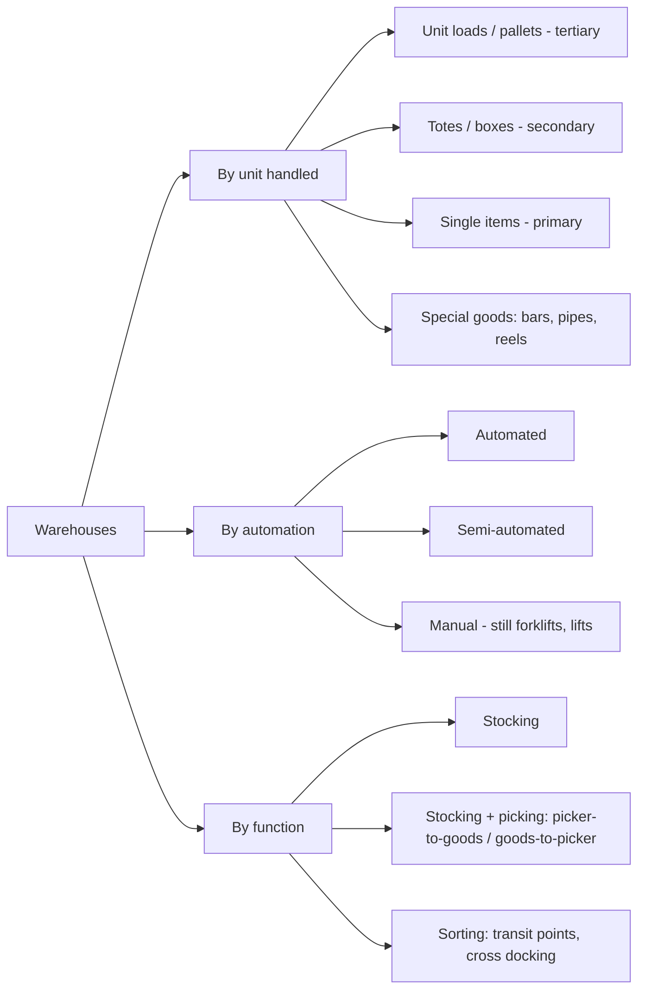

**Theory summary — Digital Warehousing & Transportation**
Short, exam-ready answers. Every topic is from Lessons 1–16. Formulas are in [[DWT - Formula Sheet-claude]].

---

## Likely theory questions (from past exams)

**Q1 — Integrated study of the product–packaging system / optimization of secondary packaging** *(exam 2, example 1)*
- Packaging is not designed alone: product → primary → **secondary (box)** → **tertiary (pallet/UL)** → **vehicle** are one system. The best box is the one that minimizes **total cost** = packaging + handling + storage + transport (+ damages), not the cheapest box.
- Rules: (1) box footprint must be a **sub-module of the pallet** (600×400, 400×300, 300×200…) so the pallet is **saturated without overhang** — a bad footprint wastes pallet area (e.g. 16.6% more cost); (2) choose UL height to saturate the truck (33 UL/layer, 66 UL/trip); (3) box cost ≈ **1.2 €/m² × developed surface S**.
- Optimizing the box: for an American box $S=(2L+2B)(H+B)=2LH+2BH+2LB+2B^2$ → **B enters squared**, so put the **smallest dimension as B**; optimal shape **L = H, B = L/2** (lesson case: −14% cost just re-orienting the dimensions).
- Example from lesson: bigger box (24 bags) costs less in transport but more in cardboard vs smaller box (12 bags): totals differ by ~1% → you must compute both packaging and transport.
- Also check supplier price: expected cost = S × 1.2 €/m²; if quoted price is higher → renegotiate.

**Q2 — Types of commercial cardboard boxes** *(example 1)*
- FEFCO codes: 02xx **slotted boxes** (0201 American: flaps meet; overlapping flaps — half or full overlap), 03xx **telescopic** (tray + lid), 04xx **folder** boxes, 05xx **slide** boxes, 06xx **rigid** cases, 07xx **automatic bottom** (ready-glued).
- Cost order (same L,B,H): American (a) < half-overlap ≈ +16÷20% < full overlap ≈ +33÷40% < telescopic ≈ +150÷330% (much more cardboard).
- Corrugated cardboard: liners + fluting; grammage [kg/m²] defines strength and price.

**Q3 — Standardization of packaging** *(example 1)*
- Why: fewer box codes → **lower safety stock**, fewer damaged/obsolete cartons, **higher quantity per code → lower price**, easier **automated** packing.
- How: **cluster analysis** on (L, B, H) with the same cardboard: Euclidean distance between boxes $d_{ab}=\sqrt{\Delta L^2+\Delta B^2+\Delta H^2}$ → merge the closest boxes; the standard box must contain both (max of each dimension) → check extra cardboard cost vs savings (price discount, stock, management). Weight by yearly quantity.

**Q4 — Cost–benefit: single-use vs reusable packaging** *(exam 6, exam 7)*
- **Single-use**: buy Q boxes/year; transport **one way only**. Cost = Q·c_box + n_trips·c_direct (+ damages).
- **Reusable not collapsible ($I_c=1$)**: buy once $N=(I_c+2)N_{trip}$ boxes (one set at the customer, one travelling, one at the vendor); the empty boxes take the same volume → **every trip is round trip**.
- **Reusable collapsible ($I_c>1$)**: $N=(I_c+2)N_{trip}$, but empties are folded: every $I_c$ trips → $I_c-1$ one-way + 1 round trip.
- Yearly packaging cost = investment / life in years, with cycles/year = Q/N and life [years] = life cycles / cycles per year (equivalently Q·c_box / life cycles).
- Trade-off: reusable = low packaging cost, higher transport (return) and investment; wins with **high volumes, short distances, frequent deliveries**, and when damages of single-use are significant. Single-use wins with long distances / low volumes. (Also: cleaning, tracking, sustainability.)

---

## Transport

**Primary vs secondary transport**
- **Primary (B2B)**: large volumes, full truck (FTL), fixed routes one origin → one destination (plant→plant, plant→DC); road, rail, sea, air, intermodal. Goal: **saturate the vehicle** (weight 28 t or volume ≈80 m³; < 400 kg/m³ → volume saturates first).
- **Secondary (B2C/distribution)**: sequence of deliveries from a warehouse to many customers (multi-drop); mainly road (vans), drones.
- Own fleet (only road) or outsourcing (any mode; rates per trip, per pallet, per kg, per m³).

**Internal vs external costs**: internal = paid by the company (driver, fuel, truck depreciation, taxes/insurance, maintenance 4–7% of investment/year, highway, loading/unloading time); external = paid by society (CO₂, pollution, noise, congestion, road damage). A big truck costs ≈ **1.4 €/km**; the €/km of a trip grows when the distance is short (fixed loading/unloading time) and if the truck comes back empty. Temperature control: +10–15% fresh, +40–50% frozen.

**Number of deliveries per vehicle**: available time (shift − time to reach the area and come back) divided by the time per delivery (stop + travel between customers). Average distance $\bar d = 0.9\sqrt{S/N}$.

**Cross docking / transit point**: warehouse without stock where goods are moved from the primary vehicle to delivery vans close to the customers. Pros: vans start inside the area → many more deliveries per van, fewer vans/drivers, fewer km; cons: cost of the cross-dock facility, handling, extra primary transport. Decision by comparing total yearly costs (lesson: ≈10% saving).

**Planning routes (secondary, own fleet)**
- **Consolidation method** (most used): fixed main routes to important customers, other daily customers added to them. + little planning work, same driver on the same route (learning effect); − longer distances.
- **Heuristic methods** (software, e.g. PTV): input = daily orders, addresses, time windows, constraints (narrow roads, unloading areas), fleet.
  - **Savings (Clarke & Wright)**: start from dedicated round trips, merge the pair with the highest saving $S_{ij}=d_{Wi}+d_{Wj}-d_{ij}$ while constraints (capacity, shift time) hold. Savings are big for customers **far from the depot and close to each other**. Objective $F=\beta d+(1-\beta)t$.
  - **Extra mile**: start from the farthest customer and add the customer with the minimum extra distance (good, but worse than savings).
- **Outsourced fleet**: rates by pallet bands → you need the **delivery spectrum** (deliveries by number of pallets) to compare providers.

---

## Warehousing

**Why digital warehousing**: warehouses + transport are the delivery network; automation and data improve throughput, space saturation, accuracy and time to market.

**Classifications**

Big hubs integrate several types → strong consolidation to cut time to market.

**Functional areas**: receiving (quality control: free-pass vs tested goods; rejected → quarantine; labelling, repackaging) → storage → picking → shipping. **Number of bays** with Poisson on truck arrivals during the unloading time (≈45 min), service level 90–95% = probability that an arriving truck finds a free bay; each bay ≈ 4.5 m of wall → affects the shape of the building. Layouts: rear vs lateral unloading (lateral for long materials, no delivery sequence constraint); in/out on the same side, opposite sides, or around.

**Selectivity index $I_S$** (warehouse parameter) = UL reachable without moving others / total UL. Single deep $I_S=1$ (needed when each item has few UL), double deep 0.5, multi-deep/drive-in lower → better **surface saturation** but needs many UL per item (batch).
**Access index $I_A$** (item parameter) = movements per day / average stock → high $I_A$ items closest to I/O.
- High movements + $I_S=1$ → AS/RS single deep; high movements + $I_S≈0.5$ → AS/RS double deep; many UL per item with high throughput → multi-deep (shuttle/push) systems.

**AS/RS (stacker crane) design logic**: input = UL dimensions/weight, capacity, max throughput (in+out/h), available height and surface. Steps: (1) machines from target cycle time (110 s simple, 100 s combined); (2) usable height (−1 m sprinkler/roof, −0.8 m floor) and floor height (UL + 0.1 gap + 0.15 beam) → floors; (3) capacity per machine → modules (3 UL each, 2.95 m) → length L; H = (floors−1)·H_F; (4) verify cycle times with FEM 9.851 and utilization U (between 0.6 and 1, availability 0.96).
- **Simple cycle**: one storage or one retrieval per trip. **Combined (dual command)**: storage + retrieval in one trip — used for picking (1 combined cycle per order line).
- **Dual AS/RS (capacity 2 UL)**: one trip handles 2 in + 2 out → ≈ +35% throughput.

**FEM 9.851**: standard to compute AS/RS cycle times on reference points $P_1(L/5; 2H/3)$, $P_2(2L/3; H/5)$; axes move simultaneously → travel time = max(t_x, t_y), trapezoidal speed profile $t=l/v+v/a$. Assumes random storage and that the rack is reasonably "square in time".

**Bozer–White**: analytical expected cycle time for random storage, rack normalized in time ($T$, shape factor $b$). Used when FEM is not applicable (e.g. **miniloads** for totes, multi-command cycles). $b\ge0.8$ good design; small $b$ = unbalanced rack (too long or too high for the speeds).

**Multi-deep / shuttle systems**: one shuttle (or push/rush mover) per level moves along x; **lifts** (separate IN and OUT) move along y and are usually the **bottleneck** → system throughput = min(levels × shuttle throughput, lift throughput). High throughput with many UL of the same item (batches).

**Miniload / totes warehouses**: totes 600×400 (h 0.2–0.5 m, ≤ 50 kg), machine carries 2–6 totes, ≈150 totes/h per machine; hold ~1 week (max 1 month) of coverage. Investment ≈ 30–50 €/box vs 300–400 €/UL for pallet AS/RS → moving storage from UL to totes can save money.

---

> [!note] Not covered in the lessons notes (yet)
> Some past exams also ask: **picking with $Z_{ih}$/$Q_{ih}$ matrices** (access curve, routing, exam 5), **AVS/R vs AutoStore** (exam 3), **shuttle number and $N_k$** (exam 5). They are not in [[Lessons - DWT]] up to Lesson 16, so they are not summarized here.
