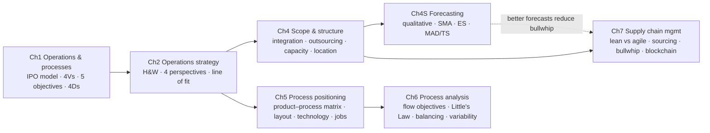

# SOSCM – Chapter summaries (index)

Chapter-by-chapter rewrite of your notes [[Summary SOSCM - Vinelli]] and [[Summary SOSCM - Macchion]] (the originals are untouched). Each chapter follows the sections you covered, adds verbatim book quotes with page links, and explains every image.

| # | Chapter | Professor | Book pages (PDF) |
|---|---|---|---|
| 1 | [[Ch01 - Operations and processes-claude\|Operations and processes]] | Vinelli | p.24–64 |
| 2 | [[Ch02 - Operations strategy-claude\|Operations and strategic impact]] | Vinelli | p.65–104 |
| 4 | [[Ch04 - Operations scope and structure-claude\|Operations scope and structure]] | Macchion | p.141–174 |
| 4S | [[Ch04S - Forecasting-claude\|Supplement: Demand forecasting]] | Macchion | p.175–184 + slides |
| 5 | [[Ch05 - Process design 1 - Positioning-claude\|Process design 1 – Positioning]] | Vinelli | p.185–214 |
| 6 | [[Ch06 - Process design 2 - Analysis-claude\|Process design 2 – Analysis]] | Macchion | p.215–258 |
| 7 | [[Ch07 - Supply chain management-claude\|Supply chain management]] | Macchion | p.259–294 |

> [!note] Not covered yet
> **Chapter 8 – Capacity management** is only a heading in [[Summary SOSCM - Vinelli]], with no content, so there is nothing to summarise yet. **Chapter 3** does not appear in your notes.

## Legend

| Box | Meaning |
|---|---|
| `[!PDF\|…]` | **Verbatim quote** from the book, with a page link that opens [[Operations-and-Process-Management-–-Gestión-por-Procesos.pdf]] (same numbering as your PDF++ highlights) |
| 📖 `[!info]` | Figure or table **in the book**: page link plus a short "how to read it" |
| 🎓 `[!example]` | **Lecture slide, photo or hand drawing not in the book**: a self-contained description of what it shows and what to say about it. Forecasting slides link to [[Forecasting_260128_162152.pdf]] when the slide is in that file |
| `[!important]` | Operations Principle to quote at the oral |
| 🎤 `[!question]` | Likely oral questions, with the key answer |

## Big-picture map (how the chapters connect)

## Recurring ideas to link at the oral
- **Volume–variety** drives everything: 4 Vs (Ch 1) → product–process matrix, layout, technology, jobs (Ch 5).
- **Trade-offs and how to overcome them:** efficient frontier (Ch 2) ↔ technology bending the diagonal (Ch 5) ↔ modular design (Micraytech).
- **Fit:** line of fit (Ch 2) ↔ natural diagonal (Ch 5) ↔ Fisher's lean/agile match (Ch 7).
- **Information flows matter as much as physical flows:** two-way flow (Ch 4) → bullwhip and information sharing (Ch 7) → forecasting (Ch 4S).
- **Sustainability / TBL:** Ch 1 → stakeholders and CSR (Ch 2) → SC sustainability and responsible operations (Ch 7).
