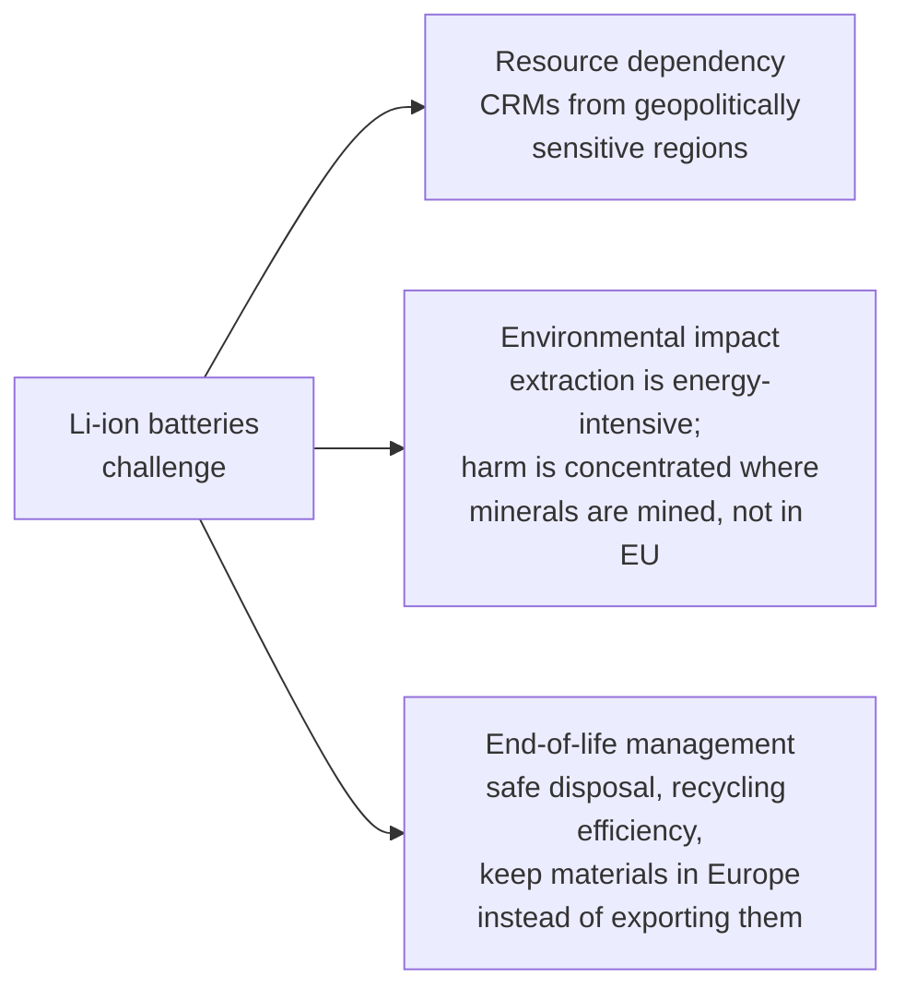
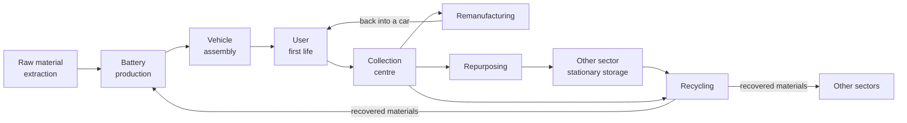
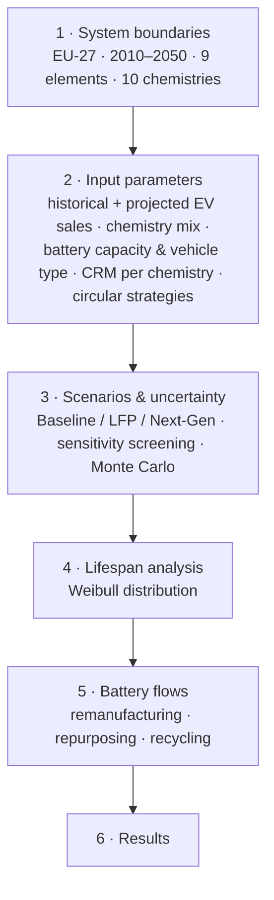
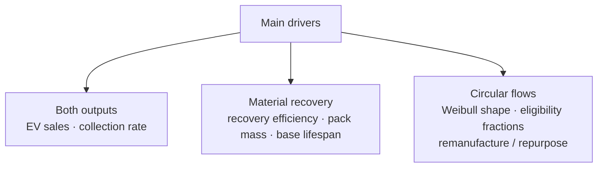
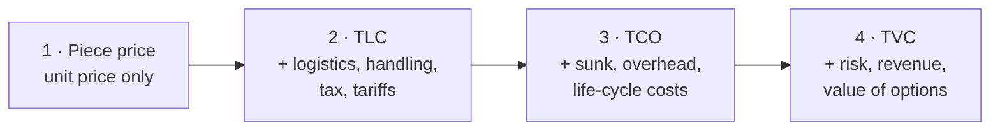
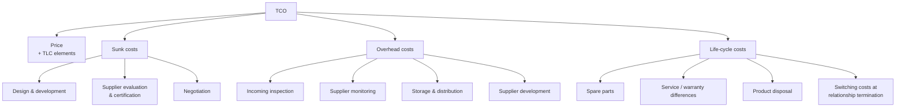
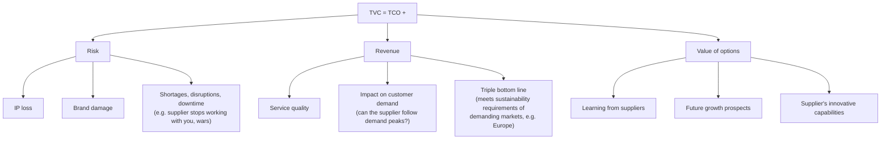

# Lecture 09/11/2026 – Battery circularity & supplier measurement criteria

> [!abstract] In one breath (for the oral)
> **Part 1 – Battery circularity (research presentation).** EV growth makes the EU dependent on **critical raw materials** (Co, Li, Ni) sourced from few countries. EU law answers with **recycling efficiency targets**, **recycled-content targets** and the **Battery Passport** (Feb 2027). Before recycling, a battery's life can be extended through **remanufacturing** (back into a car) and **repurposing** (stationary storage). A **dynamic MFA cohort model** (EU-27, 2010–2050, 3 chemistry scenarios) shows that repurposing is by far the biggest circular flow, recycling flows grow strongly after 2030, and **chemistry choice** decides whether Co/Ni end up in deficit or even oversupply, while **lithium stays in structural deficit**.
> **Part 2 – Supplier measurement criteria (Ch. 7, supplier selection).** Four nested approaches, from price to value: **Piece price → TLC → TCO → TVC**. Each one includes the previous one. The view gets wider, and so do the data needs and the effort.

Related: [[Ch07 - Supply chain management-claude]] · [[Summary SOSCM - Macchion]]

> [!warning] About the source
> Recorded in a noisy room. Some passages (the Q&A at minutes ~27–29 and ~38–39, the break around ~47–54) could not be understood and were left out. Where the recording and the slides disagree on a number, **the slide value is used**.

---

## Part 1 – Battery circularity in the EU

**Goal of the presentation:** show how EV batteries are changing Europe and which circular practices are being adopted. The second half presents a **dynamic material flow analysis (dMFA)** that follows batteries from first life in the EV, through remanufacturing / repurposing / recycling, until the critical materials are recovered and reintroduced.

**Structure:** context → industry & policy → circular strategies → research & methods → results & conclusion.

### 1. Context

**Why the topic matters**
- The automotive sector employs **~13.8 million people** in the EU and contributes **~7% of EU GDP**.
- Passenger cars alone also produce about **14% of CO₂ emissions**. The sector matters economically, but its environmental impact cannot be ignored.

**Market and regulation**
- EV sales have grown every year, steeply after 2020. One driver is the **EU limit on CO₂ emissions of new cars** (the "2035 ban").
- In **December 2025** the EU proposed **softening** the ban: about a 90% CO₂ cut instead of 100%, with lower figures also discussed. *Because the rules are unstable, it is harder for supply chain actors to plan and carry out policies.*
- 2025 EU-27 registrations (ACEA 2026): **BEV 17.4%** (1.88 M cars, up from 13.6% in 2024). Hybrids 34.5%, petrol 26.6%, **PHEV 9.4%**, diesel 8.9%.
  - **BEV** = full battery-electric (e.g. Tesla). **PHEV** = plug-in hybrid: it can be charged or run on petrol and has a **smaller battery**.

**The challenge – three sides**

**What makes a material "critical"**
The EU *Study on the Critical Raw Materials for the EU* (2023) is published **every 3 years**. It scores each material on two dimensions:
- **Economic Importance (EI)**
- **Supply Risk (SR)**

A material is **critical** if **EI ≥ 2.8 and SR ≥ 1.0**. The list of assessed and critical materials keeps **growing** with each edition (2011 → 2014 → 2017 → 2020 → 2023).

| Material | EI | SR | Comment from the lecture |
|---|---|---|---|
| **Cobalt** | 6.8 | 2.8 | Highest on both dimensions |
| **Lithium** | 3.9 | 1.9 | High on both |
| **Nickel** | 5.7 | 0.5 | High EI but **low SR thanks to supplier diversification**: if one supplier becomes a problem, others can replace it |

**Cobalt**
- **63%** of world cobalt comes from the **Democratic Republic of Congo**, which has environmental and social problems. Prices have **spiked about tenfold** for short periods in the past.
- The EU imports **81%** of its cobalt. **However**, the EU **refines it domestically** (mostly Finland, some Belgium), so dependence at the processing stage is close to zero.

**Lithium**
- The EU imports **100% of its processed lithium**. **79% comes from Chile** (slide), so a single supplier covers about four-fifths of demand. *Imports are extremely concentrated.*
- **New lithium is 3–5× cheaper than recycled lithium.** It is cheaper to stay dependent than to build recycling capacity.

**Nickel**
- The EU imports **75%** of its processed nickel: **29% Russia**, 17% Finland, 10% Norway (2023 data; the next CRM report is expected around early 2027).
- Supply is **more diversified**, so the risk is **lower**.

**Battery chemistries for EVs**

| Chemistry | Key features |
|---|---|
| **NCA** (Ni-Co-Al) | Typical of Tesla. High energy density, high cost |
| **NMC** (Ni-Mn-Co) | Very common in European cars. Ratios can be adjusted (111 → 532 → 622 → 811 → 955). Older generations used much more **cobalt**, the most problematic element, so newer ones increase Ni and reduce Co. High energy density and modular |
| **LFP** (Li-Fe-PO₄) | Developed in China. **No Ni, no Co**: the only critical element is Li. Cheaper battery, lower criticality, long life. **No large European manufacturer makes LFP**, so it comes almost 100% from China |

- EU battery sales in 2023: NCA ≈ 1/4, most of the rest NMC variants, **LFP ≈ 3%**. By **2025 LFP was above 12%** and rising fast.
- *Key point:* choosing a chemistry today is a manufacturer or consumer decision, but its effects on the supply chain will appear **15–20 years later**, when those batteries reach end of life.

### 2. Industry & policy

**Production capacity**
- EU battery production capacity is expected to grow from **292 GWh (2024) to 1,024 GWh (2030)**. Germany leads (474 GWh), followed by Poland and France.
- ⚠️ This is **announced** capacity. Several projects have already been **cancelled or delayed** because gigafactories are very expensive and demand does not always justify them. *It shows what could happen, not what will happen.*

**Recycling capacity** (Fraunhofer, 2025)
- **Spokes** carry out the **first steps** of recycling. They are cheaper to build.
- **Hubs** also **recover the valuable materials**. They are much more expensive to build and run, and their permits are harder to obtain and more heavily regulated.
- Europe has **structural overcapacity** in recycling, for two reasons:
  1. **Battery production is ramping up more slowly** than planned (projects delayed or cancelled), so fewer batteries and less production scrap are available.
  2. **Plants were built ahead of future demand**: large end-of-life flows are expected **from about 2031**, and recyclers want to capture them before they are **exported outside the EU**.

**Drivers of Li-ion battery recycling**
- **Environmental sustainability:** less need to extract new materials.
- **Resource efficiency and circular economy.**
- **Economic incentives:** EU funding and legislation.
- **Supply chain security:** dependence is concentrated in one or two countries, so keeping materials already bought inside Europe helps during disruptions.
- **Economic and social impacts.**

**EU legislation (Battery Regulation): two levers**

| | 2027 | 2031 | 2036 |
|---|---|---|---|
| **Recycling targets** (% of material entering recycling that is recovered) | Li 50% · Co 90% · Ni 90% | Li 80% · Co 95% · Ni 95% | – |
| **Recycled content** (% of recycled material in new batteries) | – | Li 6% · Co 16% · Ni 6% | Li 12% · Co 26% · Ni 15% |

- **Why Co/Ni targets are higher:** these metals are worth more, so industry already recovered them efficiently. Setting a target below current practice would make no sense.
- **Lithium** was **not recovered at all until about 7–10 years ago**, so its target starts lower.
- **Recycled content** example: if a battery contains 100 units of lithium, 6 must come from recycling in 2031 and 12 in 2036. This pushes **recyclers and manufacturers to work together**, so recovered material is actually used.

### 3. Circular strategies

**From a linear to a circular supply chain.** In the linear model, batteries go raw material extraction → battery production → vehicle assembly → user (first life) → **landfill**. In the circular model, batteries go to a **collection centre** and then to **recycling**, and the recovered materials **re-enter battery production**.

**Recycling is the last step, not the only one.** Two strategies extend battery life first:

- **Remanufacturing:** a pack that **fails early** is dismantled, repaired and its individual cells assessed, then **reinstalled in a car** as a spare part. The battery gets a few more years on the road. **Eligibility is strict** (only young, early-failed packs).
- **Repurposing:** the battery gets a **second life in stationary energy storage**, such as domestic use or **grid stabilisation**, charged and discharged with demand or alongside PV and other renewables.
  - This route is **less restrictive**: batteries used for **8–10 years** can still be repurposed. They are dismantled **to module level**, and the healthy modules are reassembled.
  - The sector is **still developing**. This is what companies are working towards, not yet standard practice.

Every battery ends in **recycling**. Its materials go back to automotive or to other sectors, depending on demand.

**Battery Passport**
- **Mandatory from 18 February 2027** for EV and industrial batteries **> 2 kWh** sold in the EU. The **producer** maintains it.
- It **breaks down information silos** between supply chain actors. Information such as **state of health** and **chemistry** becomes quickly available, which improves **traceability** and makes **reuse and recycling** easier for the next actor.

### 4. Research & methods

**Research objectives**
1. **Battery flows:** model EU-27 passenger-car battery **stocks and flows** by chemistry, age and life stage, **2010–2050**.
2. **Circular economy:** assess how remanufacturing, repurposing and recycling change end-of-life flows.
3. **Recycling:** compare **secondary supply** with **primary demand** for **9 materials** across **3 chemistry scenarios**.

**Methodology – six steps**

- **Inputs:** EV **sales** drive battery demand, so they drive all the flows. The **chemistry mix** decides how much material can be recovered. **Capacity and vehicle type** matter because battery size depends on the vehicle. **Circular strategies** decide how many batteries go into each flow and when.
- The 10 chemistries are NCA, NMC 111/532/622/811/955, LFP, and the next-generation **Li-Air** and **Li-S**. The 9 materials are Co, Al, Li, Cu, Ni, Mn, P, graphite and Si.

**Model structure (dMFA cohort model)**
- Layers: **vehicle** (BEV, PHEV) → **chemistry** → **stage** (first life k=1, remanufacture k=2, repurpose k=3, recycle) → **material**.
- Chain: EV sales → chemistry market shares → EV battery production → first life → **collection** (rate c) → **routing** to remanufacture / repurpose / recycle → recycling with **recovery efficiency η** → recovered materials go back into production. Production scrap is also recovered at η.

**Sales trajectory**
- Calibrated on Eurostat history and IEA outlooks. Modelled BEV registrations reach **1.89 M in 2025 (17.3%)**.
- **BEV and PHEV are kept separate** because PHEVs have **smaller batteries**. Mixing them would distort material quantities.
- Assumption: legislation will **discourage** new combustion-engine cars rather than ban them completely. EV sales rise above **10 M/year only by 2050**, roughly the historical average of total EU car sales.

**Three chemistry scenarios**

| Scenario | Chemistry trajectory to 2050 |
|---|---|
| **Baseline** (most likely per literature) | **NMC955 + NMC811 = 70%** of new sales; **LFP stable at ~20%** |
| **B – LFP** | **LFP rises to 60%**; NMC811 and NMC955 fall to 15% each |
| **C – Next-Gen** | **Li-Air and Li-S** enter in **2031** and reach **75%** by 2050 (no Co, no Ni, lighter, fewer elements) |

**How the scenarios were designed** *(key methodological point)*
- All three scenarios share the **same** sales trajectory, EV size mix, **collection rate (95% from 2035)**, eligibility fractions, routing shares and first-life lifespans. **Only the chemistry trajectory changes.**
- *Why:* if you change everything between scenarios, you **cannot tell what causes the difference**. Change **only the few parameters you know drive the main difference** and keep the rest the same across scenarios. Then:
  - differences **between** scenarios are explained by chemistry;
  - **uncertainty within** each scenario comes from varying the other parameters (sensitivity analysis + **Monte Carlo**, giving e.g. 95% confidence bands).

**Battery lifespan – Weibull distribution**
- Batteries are grouped into **cohorts** by **chemistry, vehicle size and year of manufacture**. Each cohort gets an average lifespan, which sets how many batteries fail each year.
- Leaving a stage follows a **Weibull** distribution with shape **α = 3.5** and scale **λ**, which depends on chemistry and build year. The curve looks similar to a normal distribution.
- **Conditional annual exit probability:** of the batteries of a cohort **still alive** at the start of year *x* (denominator), the share that **fails during year *x*** (numerator):
  $$h(x)=\frac{S(x-1)-S(x)}{S(x-1)},\qquad S(x)=e^{-(x/\lambda)^{\alpha}}$$
- Average first life is **~6 years** for the earliest cohorts and rises to **~10 years by 2050 (12 for LFP)**. Newer batteries reach second use or recycling later.

### 5. Results & conclusion

**Circular flows (deterministic central case, by 2050)**
- **Remanufacturing:** about **170k packs/year** (Baseline), 188k (LFP). The numbers barely change between scenarios because the **narrow eligibility window** acts as a bottleneck.
- **Repurposing** is the **largest circular route**: an inflow of **3.36 M packs/year** (Baseline), 3.51 M (LFP) and 3.31 M (Next-Gen), about **15× remanufacturing**. It builds a **stationary storage stock of 20.8–21.7 M packs**.
  - *Implication:* these ~20 M batteries hold a lot of material, and repurposing **delays its return** to production by several years.

**Recycling flows**
- End-of-life packs entering recycling: **~1.06 M/yr (2030) → 3.7 M (2040) → 6.6 M (2050)**, growing roughly exponentially from 2030.
- Chemistry mix of the recycling stream:
  - **Baseline:** NMC955 + NMC811 make up **63%**, so plenty of Ni, decreasing Co. All three metals are still needed in the coming decades.
  - **LFP:** LFP grows from **16% (2028) to 37%**. It rises **more slowly** because LFP lasts longer and enters recycling later.
  - **Next-Gen:** Li-S + Li-Air go from **1% (2036) to 49%** combined.

**Sensitivity analysis: what drives the outputs**
- **EV sales** and **collection rate** drive **both** output families, because they sit at the start of the system.
- **Material recovery** is then driven by **recovery efficiency** and **pack mass**, which have no effect on circular flows, followed by **base lifespan**.
- **Circular flows** are driven by the **Weibull shape** and the **eligibility fractions** for remanufacturing and repurposing.
- The screening identified **which parameters to vary in the Monte Carlo**.

**Monte Carlo: primary demand (dashed) vs recovered supply (solid) for Co, Li, Ni**
- **Baseline:** demand and recovery **both rise** at a similar pace because the sector is expanding. Later, when sales stabilise, recovery keeps growing and catches up, since batteries reach end of life about 15 years after sale.
- **LFP:** **Co and Ni demand stagnates or slows** while recovery keeps growing.
- **Next-Gen:** **Co and Ni demand falls well below the recycled quantity**. New batteries need no cobalt, but old cobalt-rich batteries are still being recycled.
- **Lithium stays in structural deficit** in every scenario.
- **Recovered-to-demand ratio:** cobalt is a **small absolute mass**, yet it can cover **~150–170% of demand**. **Mn and Ni** approach or exceed parity depending on the scenario. *Chemistry has such a big effect on demand that an **oversupply** is possible, mainly because demand **collapses**, not because recovery grows.*

**Conclusion**
- The EU automotive sector is at a **turning point** towards EVs, driven by CO₂ targets and market demand.
- This reduces emissions but could create **new supply chain dependencies and risks**.
- **Remanufacturing, repurposing and recycling** can reduce EU dependence on imported CRMs, support the circular economy and strengthen the EU's position in e-mobility.

---

## Part 2 – Supplier measurement criteria (Ch. 7 – supplier selection)

**Context.** After assessing a potential supplier's capabilities (**technical, operational, financial**), you must decide **which criteria to quantify** when comparing sources. The choice matters because each criterion has **implications** and needs **time**. The question has been debated for years.

**Four approaches, from price to value.** **Level 1 is the simplest and level 4 the hardest.** Each level **includes the previous one**, so everything starts from the **piece price**.

As you move from 1 to 4, the **breadth of view** grows from price to value, and so do the **data needs and the effort** to quantify. TVC is the broadest lens: it gives up simplicity for what really matters.

**1 · Piece price**
- Identify the part, ask several suppliers for quotes, and pick the **lowest unit price**.
- **Pros:** simple, needs minimal data, gives a clear incentive structure, and allows a **very fast comparison**.
- **Not wrong in itself.** It works if **all other variables are equal** across suppliers (same quality, same collaboration potential, same risk). In practice they rarely are: one supplier may offer **innovation** and long-term value that another cannot.
- **Limits:** it ignores non-price costs, **risks** and revenue aspects, so it can lead to **mistakes**.

**2 · Total Landed Cost (TLC)**
- Piece price **+ logistics, handling, tax, tariffs and trade compliance**.
- **Where the supplier is located** affects the final cost: transport, energy to move the parts, taxes and **unexpected duties** when goods cross borders, customs and government rules.
- It reduces the risk of **ignoring where the product comes from**. Is the product exposed to delays or unexpected taxes during shipment?
- **Limit:** its treatment of non-price costs is still **narrow**.

**3 · Total Cost of Ownership (TCO)**
Quantifies the **total or life-cycle cost** of a product or service, not just its short-term unit price.

- **Sunk costs** are paid up front and do not come back:
  - **Design & development:** if you help the supplier design the component or choose materials, you are **investing in that supplier**. Your employees' time is paid, so it is a cost.
  - **Supplier certification:** getting a certification is **very time-consuming**, apart from the fee.
  - **Negotiation:** the classic example. It takes time to define every variable that goes into the final contract.
- **Overhead costs** arise **during ongoing activities**, not at the start:
  - **Supplier monitoring:** how much time does this supplier need? Do you have to **visit every week** to check production, or once in a while? The more control is needed, the higher the cost.
  - **Incoming inspection:** when materials arrive, you **sample** the lot and test it (acceptance sampling) before production. If the supplier's **quality worsens**, you must inspect a **larger share of each lot** (e.g. more than 20%) and maybe assign a person to it, so **overhead goes up**.
- **Life-cycle costs**, e.g. **after-sales support**: you buy high-tech machinery for about €1 M. If the supplier takes **a month** to fix each problem, your line is **down for a month**.
- **Criticism:** it gives more information than piece price or TLC, but it is **time-consuming** (every element must be analysed for each supplier) and still **bases decisions on cost** rather than other performance variables.

**4 · Total Value Contribution (TVC)** – *Gray, Helper, Osborn*
- Sourcing decisions should **not aim to minimise costs** but to **maximise the organisation's long-term value**. TVC starts from the TCO factors and adds more.
- Typical questions: does the supplier **innovate**? Does it have an **R&D department** or **patents**? Can it grow with you?

- **Risk:** the supplier may decide to **stop working with you**, or a **disruption** (e.g. war) may leave you without the product. IP loss and brand damage also count.
- **Revenue:** the **quality** level the supplier delivers. Its effect on **demand**: can it handle your **peaks**, or only a stable, standard volume? **Triple bottom line:** a supplier that meets high **sustainability** standards helps you **enter different markets**. Europe is among the most demanding on sustainability.
- **Value of options:** a **long-term** view. Can the supplier's capabilities **grow to the level you will need** over time, for example in innovation?

**TVC – advantages and limits**
- ✅ Bases decisions on **customer value**, not cost. It looks at how customer value **evolves**: what the customer wants **in 5 years** may differ from today, and scenarios help plan how the company can evolve.
- ✅ Reduces the risk of choosing based on **what is easy to measure** instead of **what really matters**.
- ✅ Counters **cognitive biases** and traditional incentives that push too much attention to cost.
- ❌ Different dimensions of value are **hard to quantify**.
- ❌ Collecting data on many criteria is **very time-consuming**.
- 💡 **Remedy:** quantify only the factors that show a **meaningful difference between sources**.

**When to use which**
- **TLC** is the **fastest** method for **day-to-day** purchasing.
- **TCO and TVC** suit a **strategic** purchasing view: they help position the company **long term** and assess the market and the business. TVC is a **strategic analysis**, not a quick comparison tool.

| Approach | Adds | Main pro | Main limit |
|---|---|---|---|
| **Piece price** | – | Simple, fast, minimal data | Ignores non-price costs, risks, revenue |
| **TLC** | Logistics, handling, tax, tariffs | Accounts for supplier location | Non-price costs still narrow |
| **TCO** | Sunk, overhead, life-cycle costs | Full life-cycle cost view | Time-consuming; still cost-anchored |
| **TVC** | Risk, revenue, value of options | Long-term value & customer value | Hard to quantify; data-heavy |

---

> [!question] Possible oral questions
> - When is a raw material "critical" for the EU? Compare Co, Li and Ni.
> - Why is nickel's supply risk low despite high import dependence?
> - Difference between remanufacturing and repurposing. Which yields larger flows, and why?
> - What are the two levers of the EU Battery Regulation (recycling targets vs recycled content)?
> - Why is there recycling overcapacity in Europe today?
> - Why should only the chemistry change between scenarios in a dMFA study?
> - Piece price vs TLC vs TCO vs TVC: what does each add? Give examples of sunk and overhead costs.
> - Why does TVC better reflect customer value, and what are its limits?
